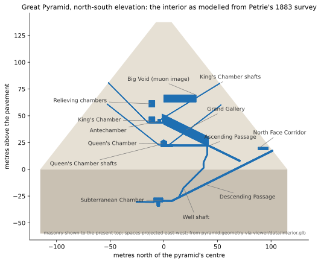
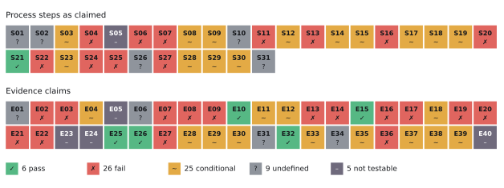
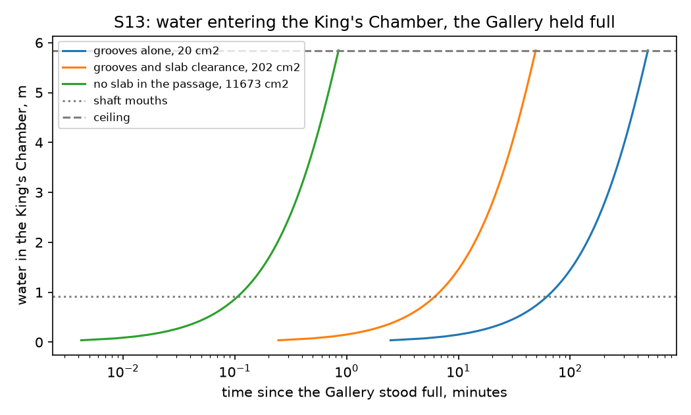
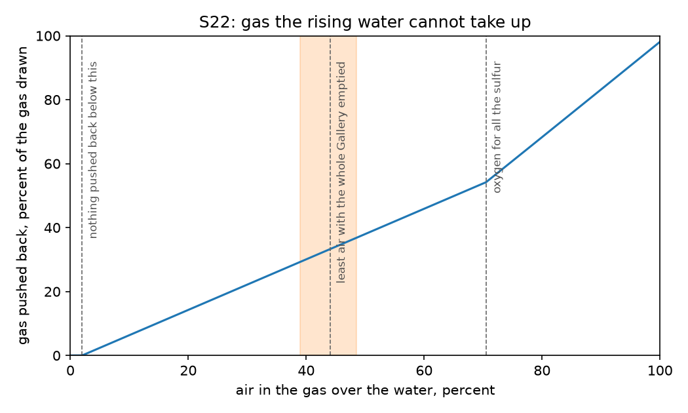
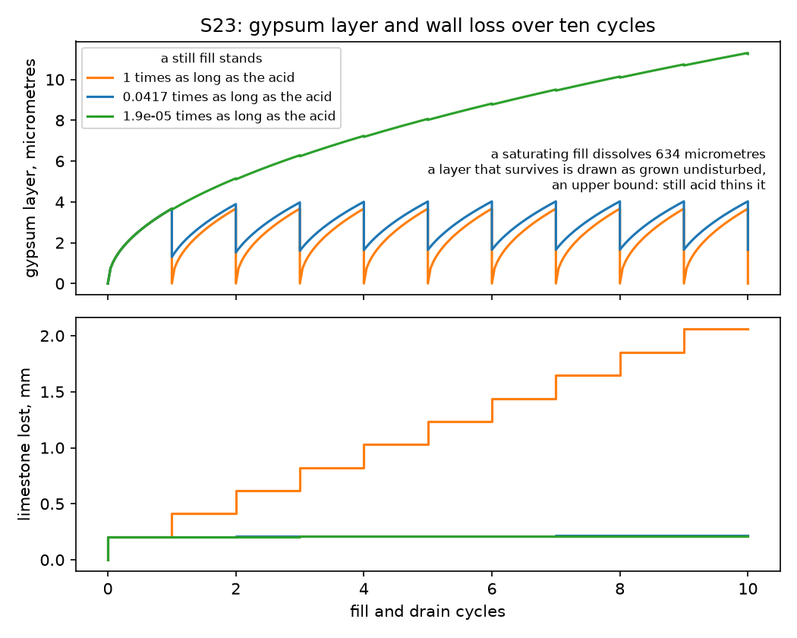
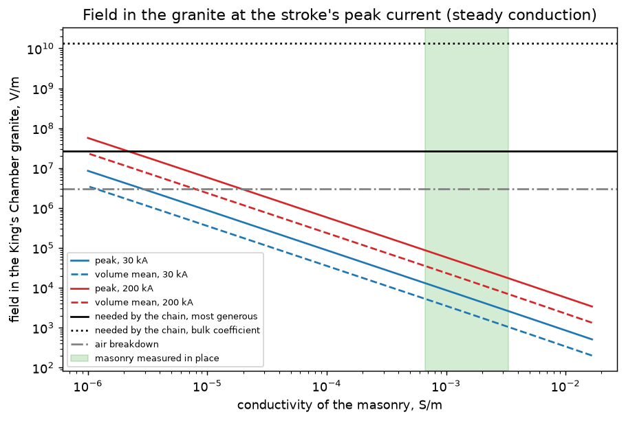
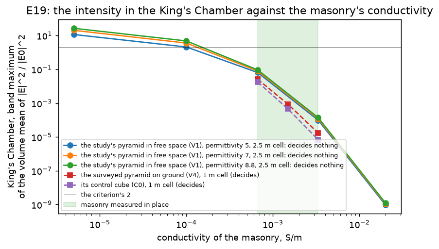
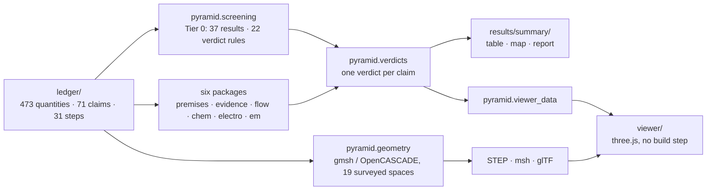

# Was the Great Pyramid a sulfuric-acid plant? A quantitative test

[](#reproduce-everything)
[](pyproject.toml)
[](#roadmap)
[](results/summary/report.md)
[](LICENSE)

A neutral, reproducible test of Geoffrey Drumm's "Land of Chem" hypothesis: that the Great Pyramid of Giza ran as a chemical plant, pumping water up its passages, drawing sulfur dioxide through an "acoustic catalyst chamber", and making dilute sulfuric acid in the Grand Gallery, as presented on the Danny Jones podcast and two History Drops clips.

The hypothesis asks for a simulation. This repository builds one, piece by piece, on three rules:

1. **Every number has a source.** 473 physical quantities, each with a value, a range, a unit, a citation and a `verified` flag, live in [one ledger](ledger/parameters.yaml). Every figure cited to Petrie's 1883 survey was checked against the scanned book: 156 figures, 155 confirmed, 1 corrected ([record](research/petrie-check.md)).
2. **Criteria come before computation.** The 71 claims of the hypothesis, its 31 process steps and 40 evidence claims, are written down as stated, each with a pass/fail criterion fixed in advance ([claims](ledger/claims.yaml)). A criterion changed after a run carries a dated note.
3. **Nothing is drawn or computed that the hypothesis does not specify.** Undefined inputs (the pump, the reservoir, the cycle time, the gas fraction) stay visible as placeholders and as `undefined` verdicts rather than being filled in. Where a model needs one, the ledger carries it as a range marked *not specified by the hypothesis*, and a verdict that turns on it is `conditional`, never decided by the default.

The result is not a debunking and not an endorsement: it is a table of what the sourced numbers allow, with every verdict traceable to the ledger line and the formula that produced it.



## Results

All 71 claims carry a verdict. Hand calculations from ledger values decide 22 (Tier 0); the survey record decides 6, a register of the documentary evidence 27, three packages of reduced models 14, and two full-wave field solvers the 2 claims about the 2018 electromagnetic study. Every verdict, with the sentence and the numbers that decide it, the figures and the modelling assumptions: [results/summary/report.md](results/summary/report.md).



| | pass | fail | conditional | undefined | not testable |
|---|---|---|---|---|---|
| 31 process steps | 1 | 11 | 13 | 5 | 1 |
| 40 evidence claims | 5 | 15 | 12 | 4 | 4 |

The rule is three-way and deliberately generous to the hypothesis: a claim **passes** only if its criterion holds at the *unfavourable* end of every input range, **fails** only if it fails even at the *favourable* end, and is **conditional** in between, in which case the basis names the input on which the outcome turns. A claim is **undefined** when its criterion cannot be evaluated without an input the hypothesis does not state, and **not testable** when its own criterion says that no computation or document can decide it. A documentary claim passes when a source that was read meets its criterion, and fails when a source that would show it was read and does not, or contradicts it.

The tables below follow the claimed cycle. Each row gives the number that decides the verdict; the full bases are in the report.

### Water

| Claim | What the hypothesis claims | Verdict | The deciding number |
|---|---|---|---|
| S08 | Water is let into the Subterranean Chamber from a reservoir | conditional | The highest documented water stands 15 m (10 to 18) below the foot of the Descending Passage; an assumed reservoir must stand 51.5 m above the pavement to fill the Gallery by communicating vessels, and supply 866 m^3 (808 to 924) per fill |
| S09 | Water stands at reservoir level in the well shaft | conditional | No reservoir is evidenced; a pavement-level one leaves water 51.5 m below the Gallery roof |
| S10 | A pump in the Descending Passage lifts the water | undefined | No actuator or seal is named; it would need 0.43 to 1.01 MN and hold 0.80 MPa |
| S11 | The retracting pump draws water up from an aquifer | **fail** | Suction margin -5.9 m at the Old Kingdom flood peak, -0.4 m at the best documented level |
| S12, S18 | Four strokes fill the Grand Gallery | conditional | 4.3 strokes (3.9 to 4.7) only if a stroke sweeps the whole passage; 5.9 to 6.7 otherwise |
| S13 | The Gallery stands full of water while the King's Chamber holds the gas | **fail** | The water stands 8.5 m (8.3 to 8.6) above the antechamber floor and presses with 83 kPa, so an opening that passes gas passes water: it reaches the King's Chamber shaft mouths in 6 minutes (4 to 7) past slabs as loose as the surviving fragment |
| E14 | Cadman's hydraulic-ram model shows the pump works | **fail** | One Gallery fill spills 2022 m^3 of drive water into a 300 m^3 chamber with no outfall |
| E17 | Wet fill in the pit shows the aquifer was tapped | **fail** | The pit as built cleared the flood peak by 11.4 m; the 1837 shaft comes within 2.9 m of today's water table |



*S13: with the Gallery full, the water that the antechamber path lets through reaches the King's Chamber shaft mouths in between a few seconds and an hour, depending on the opening.*

### Gas

| Claim | What the hypothesis claims | Verdict | The deciding number |
|---|---|---|---|
| S01, E01 | Hydrogen sulfide rises under the plateau | undefined | One batch needs 454 kg of hydrogen sulfide; the hypothesis states no cycle rate, and no opened source gives a measured flux for any seep under the plateau |
| S03 | Sulfur dioxide stays in the King's Chamber with its shafts open | conditional | By diffusion alone half the charge lasts 361 years (271 to 460); through the claimed gas path at the chamber's floor half is gone in about 69 minutes (41 at the fastest); the hypothesis states neither the wait nor what keeps the gas in |
| S14 | The falling water draws outside air down the King's Chamber shafts | conditional | 60 % of the replacement gas comes down the shafts for a 1 h drain; 20 to 100 % over the drain times and joint widths taken, and 0 % if the antechamber path is shut |
| S15, E12 | The four grooves carry the gas past the three slabs | conditional | Petrie's groove depths run out to between 0.0 and 5.1 mm at the doorway: a connected duct, 0.0021 m^2 at most, exists only in the reading that lets them reach it |
| S17 | The gases pass into the Gallery through the antechamber | conditional | 100 % of the displaced volume with gas-tight masonry; 78 % (38 to 100 %) with leaking joints, reaching the criterion's 90 % with joints tighter than about 0.11 mm (0.04 to 0.24) |
| S22 | No gas is pushed back as the water rises again | **fail** | At least 44 % of the gas over the water is outside air, whose nitrogen hardly dissolves: 33 % (29 to 37 %) of the gas is pushed back even if all the sulfur dioxide dissolves |



*S22: the gas the rising water cannot take up, against the air in it. The band is the least air a full stroke draws.*

### Chemistry

| Claim | What the hypothesis claims | Verdict | The deciding number |
|---|---|---|---|
| S16 | Sulfur dioxide becomes trioxide in the antechamber | **fail** | Uncatalysed lifetime 8.8 billion years; converted fraction at most 9 x 10^-14 |
| S19 | The sulfur dioxide dissolves in the Gallery water | conditional | 87 % crosses the surface in a 24 h cycle; 0.1 to 97 % over the cycle times and film coefficients taken, none of which the hypothesis states |
| S20 | Sulfurous acid is oxidised quickly to sulfuric acid | **fail** | One day's oxygen oxidises 2.5 % (2.1 to 2.8 %) of a batch |
| S21 | Staged filling prevents boil-over | **pass** | The worst fill warms by 7.3 K, leaving 62 to 73 K to boiling |
| S23 | A calcium sulfate layer forms on the walls and stops further attack | conditional | The layer grows to 3.7 micrometres in a 24 h cycle (0.1 to 74); one fill of fresh water can dissolve 0.63 mm of gypsum, 173 times that, so whether it lasts turns on how long the fresh water stands, which the hypothesis does not state |
| E29 | A gypsum coat protects the limestone walls | conditional | Bare limestone neutralises 41 % (32 to 77 %) of a batch before gypsum can saturate |
| S24 | The Big Void is a heat exchanger for the reaction | **fail** | A full batch warms the Gallery water by 1.8 K (2.0 K at most) |
| S27 | Dilute acid and salt give hydrogen chloride in Khafre's pyramid | **fail** | HCl partial pressure 1.2 x 10^-7 atm, against a 10^-5 atm fail line |
| S30 | The acid is strong enough for leaching and metallurgy | conditional | Ceiling 0.023 mol/L (0.026 at most), below the 0.05 mol/L pass line at any gas fraction |



*S23: the gypsum layer and the wall loss over ten cycles, for three lengths of time the fresh water stands against the wall.*

### Electricity and sound

| Claim | What the hypothesis claims | Verdict | The deciding number |
|---|---|---|---|
| S04 | Ground currents build a field at the top and in the granite | **fail** | 0.04 V/m in the King's Chamber granite at the most, 8.8 orders of magnitude below the 2.7 x 10^7 V/m at which the piezoelectric chain, at its most generous, first reaches a documented acoustic effect |
| E21 | Ore deposits concentrate the ground current | **fail** | Sheets of the most conductive hematite measured give 2.3 times the far field (0.4 to 4.2), against 2.2 without them: 0.08 V/m at the most |
| S06 | Lightning charges the granite | **fail** | A 30 kA stroke puts 4.3 kV/m in the granite; the favourable corner, 200 kA in the most resistive masonry measured, gives 88 kV/m, 303 times short of the need, which is itself 8.9 times the field at which air breaks down |
| E22 | The granite stores the storm's field | **fail** | Charge relaxes in 5.3 ms (21 ms at most); limestone in 31 ns; storm fields change over seconds |
| S07 | The granite leaf emits ultrasound when the field drives it | **fail** | 76 dB (158 dB with every input at its generous end) against 190 dB to cavitate a wet film |
| E18 | Ultrasound can double a gas reaction rate | conditional | 1.4 to 2.3 times at 172 dB, the strongest airborne ultrasound engineered, depending on the barrier |
| E13 | The antechamber has the most striking acoustics in the pyramid | **fail** | Decay time 3.3 s against 8.8 s in the King's Chamber and 4.6 s in the Gallery, last of three; first in modal quality factor by 1.05 times (0.73 to 1.42) |
| S25 | The Queen's Chamber shaft slab is an ultrasonic level meter | **fail** | The signal arrives at -51 dB |
| E19 | The 2018 study: the pyramid's shape concentrates the field in the King's Chamber | **fail** | As the study modelled it, the mean intensity in the chamber is 1.33 to 1.36 times that of the same chamber inside a cube of the pyramid's volume, against the 2 times asked; with the surveyed chambers, a ground and the masonry conductivity measured in place, the intensity in the chamber is 0.02 to 0.03 of the incident wave's at the most favourable conductivity, against the 2 asked |
| E20 | The field excludes the tip, so the flat top is functional | **fail** | The mean intensity in the top masonry is 1.08 times as high with the apex cut at the present top as with a pointed apex (0.37 against 0.34), against the 2 times asked |



*S06: the field a lightning stroke leaves in the granite, against what the piezoelectric chain needs. The band is the masonry conductivity measured in place.*



*E19: the intensity in the King's Chamber against the conductivity of the masonry. The line is the criterion's 2; the masonry measured in place lies between 6.7 x 10^-4 and 3.3 x 10^-3 S/m. The squares, at a 1 m cell, decide; the curves, at a 2.5 m cell, show the trend and decide nothing. Both solvers first reproduce the study's free-space extinction peaks (336 m and 230 m, within 1.1 % in wavelength and 5 % in extinction); the time-domain solver, the one that carries a ground, gives the on-ground maximum at 247 m, 1.2 % off in wavelength and 13.7 % in extinction.*

### The plateau and the cycle's pace

| Claim | What the hypothesis claims | Verdict | The deciding number |
|---|---|---|---|
| S28, S29, E38 | Iron-oxide veins wire the plateau | conditional | Needs a conductivity contrast of 2.7 x 10^5; the best measured hematite reaches 3.3 x 10^4 in 100 ohm m rock and 1.0 x 10^6 in the most resistive rock; no Giza vein has been measured |
| S31 | The cycle is paced by storms | undefined | At most 0.12 direct strikes per year; the hypothesis states no cycle rate |

### The building and the documents

Six claims pass. One is a process step (S21, above). The other five are statements about the building or the record that the hypothesis cites, and the sources bear them out: air flowed when the southern King's Chamber shaft was cleared in 1837 (E10); the south passage of the Subterranean Chamber ends blind in rock, 16.41 m long (E15); the Queen's Chamber shaft mouths stayed closed by a plate of the wall stone until 1872 (E25); the 1978 analysis letter lists calcite, halite and gypsum (E26); and the muon image of 2017 shows a void at least 30 m long above the Gallery (E32).

Of the 27 claims decided from the documentary register, 2 pass, 8 fail, 7 are conditional, 5 are undefined and 5 are not testable. The bases keep two kinds of fail apart. Seven are *no evidence found*: the source the claim rests on was read and does not show it, as with the element match of E02, the lined shaft under the King's Chamber floor of E08 and the valve fittings of E16; for E27 the one example its criterion names, no sodium chloride in the wetted zone, is the opposite of what two analyses found. One is *contradicted*: the patent cited for E07 burns hydrogen sulfide at 900 C or more, or oxidises it over a catalyst from 200 C, and none of its steps runs at ambient temperature without a catalyst.

### What the conditional verdicts turn on

Twenty-five verdicts are conditional. Thirteen of them are process steps, and most of those turn on a quantity the hypothesis leaves unstated; stating it would let the same code decide the claim: the level, volume and inlet of the reservoir (S08, S09); the stroke of the pump (S12, S18); the wait between delivery and draw, and what keeps the gas in the chamber (S03); the drain rate of the Gallery and how its masonry is made gas-tight (S14, S17); the cycle time, and whether the gas over the water stands still or convects (S19); how long fresh water stands against the walls (S23); the gas fraction of a batch (S30). The others turn on a measurement nobody has made: whether the antechamber grooves reach the doorway (S15, E12), and the conductivity of an iron-oxide vein at Giza (S28, S29, E38).

## What the evidence says the structure was for

[research/10-process-gaps-and-purpose.md](research/10-process-gaps-and-purpose.md) lists, subsystem by subsystem, what the claimed process would still need (a water source at the inlet level, a head source, a pump, an oxidation mechanism, an oxygen supply, a sulfur feed, gas containment, surviving walls) and sets each against the evidence, with status words that distinguish *not evidenced*, *contradicted by measurement*, *physically excluded* and *unknown*. Its conclusion, stated no further than the sources go: the pyramid was built in Khufu's reign, bears his name, and was built by an organised workforce housed on site (Merer's logbook, read at source); it carries what the sources name as the furnishings of a royal funerary complex; the evidence base holds no positive evidence of an industrial purpose, every trace offered as diagnostic of acid has a documented non-acid source or no analysis, and the one test that could discriminate, sulfur isotopes of the chamber gypsum against mortar and bedrock, has never been run.

## How it is built



- **Ledger** ([`ledger/`](ledger/)): the single source of truth. A strict loader rejects unknown keys, non-finite values and unverified-as-text flags, so a typo cannot pass as a measurement.
- **Screening** ([`pyramid/screening.py`](pyramid/screening.py)): 37 hand calculations as pure functions of ledger values. Ranges are evaluated at the corners of the input ranges; verdicts apply the three-way rule; each basis sentence is generated from the numbers it cites.
- **Simulation packages**: each decides claims Tier 0 left pending, by the criterion committed for them. Every physical number comes from the ledger, each model is tested against a closed-form case before its results are used, and its assumptions are listed in the report.
  - [`pyramid/premises.py`](pyramid/premises.py): the survey values in the ledger against the geometric premises; the two readings of a disputed feature are the two ends of the three-way rule.
  - [`pyramid/evidence.py`](pyramid/evidence.py) with [`ledger/evidence.yaml`](ledger/evidence.yaml): a register of what the research files found for each documentary claim, with the sources and whether each was read at source.
  - [`pyramid/flow/`](pyramid/flow/): hydrostatics of the filled system, a conductance network for the gas drawn in as the Gallery drains, and the retention of a dense gas in a chamber with two open shafts.
  - [`pyramid/chem/`](pyramid/chem/): two-film transfer across the Gallery's free surface, sulfur(IV) speciation and iron-catalysed oxidation limited by oxygen, the gas the rising water must displace, calcite attack and a gypsum layer over ten fill and drain cycles, and the hydrogen sulfide a batch needs.
  - [`pyramid/electro/`](pyramid/electro/): a three-dimensional steady conduction solver (finite volumes) for a ground current over conductive sheets and for a lightning stroke at the summit, the field the piezoelectric and acoustic chain needs, and the modes of the three rooms.
  - [`pyramid/em/`](pyramid/em/): the cases of the 2018 electromagnetic study in two independent solvers written for this project in numpy and scipy, a volume-integral (coupled-dipole) solver in the frequency domain and a finite-difference solver in the time domain, both gated by the Mie series for a sphere.
- **Verdicts** ([`pyramid/verdicts.py`](pyramid/verdicts.py), [`pyramid/summary.py`](pyramid/summary.py)): one verdict per claim. Tier 0 verdicts stand; a package decides only claims Tier 0 left pending, and the merge is an error if two sources decide the same claim, so a verdict never changes silently. The table, the verdict map and the report are generated from the merge.
- **Geometry** ([`pyramid/geometry/`](pyramid/geometry/)): a parametric model of the interior from Petrie's survey, with nine variant switches for readings the sources leave open, self-checks against ledger volumes, and exporters for field solvers (STEP, Gmsh msh) and the viewer (glTF). A second model reproduces the simplified geometry of Balezin et al. (2018), the electromagnetic study the hypothesis cites.
- **Viewer** ([`viewer/`](viewer/)): a full-screen three.js scene that tours the 31 steps of the cycle exactly as claimed, with each step's claim, verdict and deciding sentence in a caption, and the compounds the hypothesis names labelled in the spaces it puts them in; products of steps that fail or are undefined are marked *claimed*. Mechanisms the hypothesis leaves unspecified are drawn as dashed, labelled placeholders. The inspector, with the deciding numbers of each step and space, comes with the next plan. A fixed notice reads: *Animation of the claim. Not a simulation result.*
- **Provenance**: every generated file carries a manifest with the commit, the ledger digest and library versions, and a test fails if the committed results were generated from a different ledger than the one in the tree.

## Evidence base

[`research/`](research/) holds the hypothesis as stated ([00](research/00-hypothesis.md): steps S01 to S31, evidence claims E01 to E42, and about thirty inputs it leaves undefined), one file per domain ([geometry](research/01-geometry.md), [hydraulics](research/02-hydraulics.md), [chemistry](research/03-chemistry.md), [electromagnetics and piezoelectricity](research/04-electromagnetics-piezo.md), [acoustics](research/05-sonochemistry-acoustics.md), [archaeology](research/06-evidence-archaeology.md), [plateau geology](research/07-plateau-geology.md)), each closed by a dated verification pass whose corrections override the first reading, a [recomputation](research/09-recomputation.md) of every derived figure with conflicts resolved, and the [synthesis](research/10-process-gaps-and-purpose.md). Values that could only be read from abstracts, secondary pages, OCR text or memory are flagged as such throughout.

## Reproduce everything

Requires Python 3.12 and [uv](https://github.com/astral-sh/uv). Gmsh is installed as a Python wheel; no system packages are needed.

```
uv sync
uv run pytest -W error
```

Regenerate the results from the ledger, from the repository root, in this order:

```
uv run python -m pyramid.screening          # results/tier0/: the Tier 0 table and the first verdicts
uv run python -m pyramid.premises           # results/premises/
uv run python -m pyramid.evidence           # results/evidence/
uv run python -m pyramid.flow               # results/flow/
uv run python -m pyramid.chem               # results/chem/
uv run python -m pyramid.electro            # results/electro/: about three minutes
uv run python -m pyramid.em --certified     # results/em/cache/ (ignored by git): the 41 deciding field runs, hours on eight cores
uv run python -m pyramid.em                 # the 171 gate and variant runs not yet cached, hours again; then results/em/
uv run python -m pyramid.geometry.export    # results/geometry/: STEP files of both levels (ignored by git)
uv run python -m pyramid.viewer_data        # viewer/data/: the viewer's models, claims and cycle
uv run python -m pyramid.elevation          # docs/figures/interior-elevation.svg, drawn from the viewer's model
uv run python -m pyramid.summary            # results/summary/: the verdict table, the verdict map and the report
```

Generated files are regenerated on a clean tree, after the commit that changes the code or the ledger, and are committed separately. The `manifest.json` beside them then records the commit that produced them. A test fails while any committed result was generated from another ledger than the one in the repository.

To edit an assumption, change the ledger line, rerun the commands, and read the new report (the field runs need repeating only if the line is one the field package reads; see [Status and limits](#status-and-limits)): no number is hard-coded anywhere else.

## Viewer

```
python3 -m http.server 8765 --directory viewer
```

Then open http://localhost:8765/. three.js 0.170.0 loads from the jsDelivr CDN, so the page needs a network connection and a browser with WebGL 2; nothing is installed.

The page is one full-screen scene. From outside, the pyramid stands on a plain sand plateau under a sky. On the steps that act inside the stone, the masonry turns to dark glass and the passages and chambers show through it as a lit schematic; the plateau fades, and the sky behind the glass darkens, only while the camera is inside the masonry. *Play the claimed cycle* flies in from far outside, then rides a camera path through each of the 31 claimed steps: water rises and falls in the spaces the claim names, gases light up the chambers they pass through, and a storm sky appears only on the two steps whose claim states a storm (S05 and S06), with the lightning strike on the top in S06. The water and gases in each space carry the formulas of the compounds the hypothesis names for them and take those compounds' colours; a product of a step whose verdict is fail or undefined is drawn hatched and labelled *(claimed)*, and the calcium sulfate coat of S23 is drawn as a faint film with its edges outlined. Mechanisms the hypothesis leaves unspecified (the pump, the valves, the reservoir, the drains) are dashed, labelled boxes. A caption gives each step's claim as stated, its verdict and the sentence that decides it, above a strip of 31 ticks coloured by verdict. A fixed notice reads: *Animation of the claim. Not a simulation result.*

| Input | Action |
|---|---|
| Space | play or pause |
| Left, Right | previous or next step |
| drag on the strip | scrub |
| F | fullscreen |
| H | hide or show the caption and controls (the notice stays) |
| Esc | back to the cinematic view |
| I | the inspector (next plan; does nothing yet) |
| pointer on the scene | orbit; this pauses the ride, and *Resume ride* rejoins it |

Deep links: `#S16` opens that step; any other fragment opens the prologue. `?quality=low`, `?quality=medium` or `?quality=high` fixes the rendering tier (pixel ratio, shadows, bloom, gas particles); without it the page times two seconds of frames and picks one. A tier set from the browser console with `viewer.store.set({quality: 'high'})` is remembered in that browser. With the system setting for reduced motion, steps cut instead of flying. `viewer.state()` in the console summarises what the scene shows.

The inspector (step and space cards with the deciding numbers, layers, a cutaway, the chemistry legend and the reaction equations), Results mode for the process model's output, the phone layout polish, and a public URL come with the next plan ([design](docs/superpowers/specs/2026-10-10-cinematic-viewer-design.md)).

## Roadmap

Built in pieces, each with a design document, an implementation plan and a review before the next starts ([`docs/superpowers/`](docs/superpowers/)):

1. **Foundation** (done): ledger, Tier 0 screening, geometry, a first viewer.
2. **Cinematic viewer, part 1** (done): the full-screen scene, the guided tour of the claimed cycle, and every compound the hypothesis names shown in the space it puts it in, with the products of failed steps marked *claimed* ([design](docs/superpowers/specs/2026-10-10-cinematic-viewer-design.md)).
3. **Simulations** (done): the 49 claims Tier 0 left open, decided by the survey record, the documentary register, reduced models of flow, chemistry and conduction, and two field solvers for the 2018 electromagnetic study ([design](docs/superpowers/specs/2026-10-11-simulations-design.md); cases and criteria in the [foundation spec](docs/superpowers/specs/2026-10-10-foundation-em-reply-design.md), section 6).
4. **Next**: the viewer's inspector and Results mode (the deciding numbers of each step and space, a cutaway, computed state beside the claim); a time-resolved model of the whole cycle that composes the flow and chemistry packages ([spec](docs/superpowers/specs/2026-10-10-process-simulation-results-mode-design.md)); the King's Chamber rebuilt with its five relieving compartments, gable and coffer ([spec](docs/superpowers/specs/2026-10-10-chemistry-display-kings-chamber-design.md)); a cross-check of the field results in MEEP and FEniCSx.
5. A written reply to the proponent.

Open-source tools only: numpy, scipy, Gmsh and three.js today, MEEP and FEniCSx for the cross-check. Anyone can rerun every result.

## Status and limits

- Tier 0 verdicts are single-point calculations with corner-evaluated ranges. The package verdicts come from reduced models, whose assumptions are listed with them in the [report](results/summary/report.md): prismatic vessels and an orifice law for water and gas, film coefficients for transfer across the water's surface, steady conduction for ground current and for a lightning stroke, hard-walled boxes for the rooms. None is a solved flow or a reacting field. Where a verdict is `conditional`, its basis names the input that a stated quantity, a measurement or a fuller model would have to supply.
- The two field solvers were written for this project because MEEP and FEniCSx have no pip packages. At a 2.5 m cell they agree with each other within 1 % in extinction and reproduce the study's published peaks; at that cell neither matches the exact (Mie) solution for a sphere within the 2 % the benchmark asks, so those runs gate the reproduction and decide nothing. A verdict rests only on runs at a finer cell where the solver does match it: 1.67 m for the dipole solver, 1 m for the time-domain one. Only the time-domain solver carries a ground, so E20 and the realism part of E19 rest on one solver, and the as-modelled part of E19 is settled at the study's own permittivity of 5 only. A cross-check in independent codes is still to come.
- The field runs take hours and their cache is not in the repository. `python -m pyramid.em --certified` recomputes the deciding runs and the plain `python -m pyramid.em` the gate and variant runs, and until every deciding run is cached the package writes nothing, so the committed `results/em/` stands. An edit of a ledger line the field package does not read leaves `results/em/` valid; an edit of one it reads (an id beginning `paper.`, `em.`, `emx.`, `pyr.`, `kc.`, `qc.` or `gg.`) makes it refuse its cache, and the runs have to be repeated.
- Thresholds such as "one day" for a cycle or 0.05 mol/L for a usable acid are judgement calls recorded beside the criterion; the hypothesis sets none. Where a package had to read a word the criterion leaves open ("ranks first", "about", "comparable", "non-negligible"), the basis says so. Two Tier 0 verdicts (S09, S20) have an alternative reading recorded in the [handover notes](docs/superpowers/plans/2026-10-10-foundation-ledger-geometry-viewer-handover.md).
- The viewer's caption shows the opening of each basis; the whole sentence is in the report. The viewer draws only the modelled interior, so hydrogen chloride (S27, in Khafre's pyramid) appears in no scene: S27 and S28 have no actors.
- The display colour of dilute sulfuric acid sits close to the verdict colour for *fail*; the *(claimed)* label beside the liquid tells them apart.
- Licensed under the [MIT License](LICENSE). The cited sources keep their own rights; transcripts of the source videos are not redistributed.

## Sources

- W. M. F. Petrie, *The Pyramids and Temples of Gizeh* (1883). The scanned book was read page by page for the gate check.
- M. Balezin, K. V. Baryshnikova, P. Kapitanova and A. B. Evlyukhin, "Electromagnetic properties of the Great Pyramid: first multipole resonances and energy concentration", *J. Appl. Phys.* 124, 034903 (2018).
- Sessa et al. (2026), *Sci. Rep.* 16, 12586: in-situ analysis of the Queen's Chamber deposits.
- The hypothesis as stated: Danny Jones, "New Scans Expose An Unfortunate Secret Under the Pyramids | Geoffrey Drumm" (2026-01-02), and History Drops, "Incredible New Evidence Reveals the Great Pyramids True Purpose", parts 1 and 2 (2026-02-28, 2026-03-04). Transcripts are not redistributed here.

The full source list, with what was read at source and what only through an abstract or a secondary page, is at the end of each research file.
