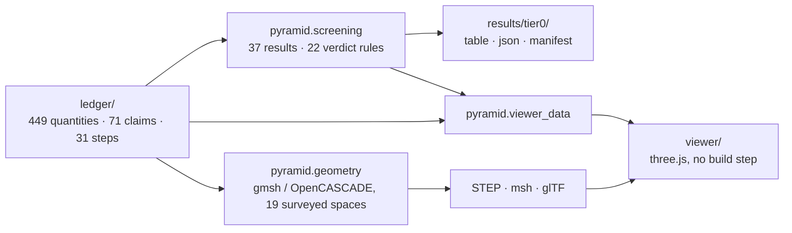

# Was the Great Pyramid a sulfuric-acid plant? A quantitative test

[](#reproduce-everything)
[](pyproject.toml)
[](#roadmap)
[](results/tier0/tier0.md)
[](LICENSE)

A neutral, reproducible test of Geoffrey Drumm's "Land of Chem" hypothesis: that the Great Pyramid of Giza ran as a chemical plant, pumping water up its passages, drawing sulfur dioxide through an "acoustic catalyst chamber", and making dilute sulfuric acid in the Grand Gallery, as presented on the Danny Jones podcast and two History Drops clips.

The hypothesis asks for a simulation. This repository builds one, piece by piece, on three rules:

1. **Every number has a source.** 449 physical quantities, each with a value, a range, a unit, a citation and a `verified` flag, live in [one ledger](ledger/parameters.yaml). Every figure cited to Petrie's 1883 survey was checked against the scanned book: 156 figures, 155 confirmed, 1 corrected ([record](research/petrie-check.md)).
2. **Criteria come before computation.** The 71 claims of the hypothesis, its 31 process steps and 40 evidence claims, are written down as stated, each with a pass/fail criterion fixed in advance ([claims](ledger/claims.yaml)). A criterion changed after a run carries a dated note.
3. **Nothing is drawn or computed that the hypothesis does not specify.** Undefined inputs (the pump, the reservoir, the cycle time, the gas fraction) stay visible as placeholders and as `undefined` verdicts rather than being filled in.

The result is not a debunking and not an endorsement: it is a table of what the sourced numbers allow, with every verdict traceable to the ledger line and the formula that produced it.


## Headline results (Tier 0 screening)

Twenty-two of the 71 claims can be decided by hand calculation from ledger values. The rule is three-way and deliberately generous to the hypothesis: a claim **passes** only if its criterion holds at the *unfavourable* end of every input range, **fails** only if it fails even at the *favourable* end, and is **conditional** in between. Full table with formulas and bases: [results/tier0/tier0.md](results/tier0/tier0.md).

| Step | What the hypothesis claims | Verdict | The deciding number |
|---|---|---|---|
| S07 | The granite leaf emits ultrasound when a storm field drives it | **fail** | 76 dB (158 dB with every input at its generous end) against 190 dB to cavitate a wet film |
| S09 | Water stands at reservoir level in the well shaft | conditional | No reservoir is evidenced; a pavement-level one leaves water 51.5 m below the Gallery roof |
| S10 | A pump in the Descending Passage lifts the water | undefined | No actuator or seal is named; it would need 0.43 to 1.01 MN and hold 0.80 MPa |
| S11 | The retracting pump draws water up from an aquifer | **fail** | Suction margin -5.9 m at the Old Kingdom flood peak, -0.4 m at the best documented level |
| S12, S18 | Four strokes fill the Grand Gallery | conditional | 4.3 strokes (3.9 to 4.7) only if a stroke sweeps the whole passage; 5.9 to 6.7 otherwise |
| S16 | Sulfur dioxide becomes trioxide in the antechamber | **fail** | Uncatalysed lifetime 8.8 billion years; converted fraction at most 9 x 10^-14 |
| S20 | Sulfurous acid is oxidised quickly to sulfuric acid | **fail** | One day's oxygen oxidises 2.5 % (2.1 to 2.8 %) of a batch |
| S21 | Staged filling prevents boil-over | **pass** | The worst fill warms by 7.3 K, leaving 62 to 73 K to boiling |
| S24 | The Big Void is a heat exchanger for the reaction | **fail** | A full batch warms the Gallery water by 1.8 K (2.0 K at most) |
| S25 | The Queen's Chamber shaft slab is an ultrasonic level meter | **fail** | The signal arrives at -51 dB |
| S27 | Dilute acid and salt give hydrogen chloride in Khafre's pyramid | **fail** | HCl partial pressure 1.2 x 10^-7 atm, against a 10^-5 atm fail line |
| S28, S29, E38 | Iron-oxide veins wire the plateau | conditional | Needs a conductivity contrast of 2.7 x 10^5; the best measured hematite reaches 3.3 x 10^4; no Giza vein has been measured |
| S30 | The acid is strong enough for leaching and metallurgy | conditional | Ceiling 0.023 mol/L (0.026 at most), below the 0.05 mol/L pass line at any gas fraction |
| S31 | The cycle is paced by storms | undefined | At most 0.12 direct strikes per year; the hypothesis states no cycle rate |
| E14 | Cadman's hydraulic-ram model shows the pump works | **fail** | One Gallery fill spills 2022 m^3 of drive water into a 300 m^3 chamber with no outfall |
| E17 | Wet fill in the pit shows the aquifer was tapped | **fail** | The pit as built cleared the flood peak by 11.4 m; the 1837 shaft comes within 2.9 m of today's water table |
| E18 | Ultrasound can double a gas reaction rate | conditional | 1.4 to 2.3 times at 172 dB, the strongest airborne ultrasound engineered, depending on the barrier |
| E22 | The granite stores the storm's field | **fail** | Charge relaxes in 5.3 ms (21 ms at most); limestone in 31 ns; storm fields change over seconds |
| E29 | A gypsum coat protects the limestone walls | conditional | Bare limestone neutralises 41 % (32 to 77 %) of a batch before gypsum can saturate |

Totals: 1 pass, 9 conditional, 10 fail, 2 undefined, 49 pending the later pieces (hydraulics, chemistry, electromagnetics, plateau network).

## What the evidence says the structure was for

[research/10-process-gaps-and-purpose.md](research/10-process-gaps-and-purpose.md) lists, subsystem by subsystem, what the claimed process would still need (a water source at the inlet level, a head source, a pump, an oxidation mechanism, an oxygen supply, a sulfur feed, gas containment, surviving walls) and sets each against the evidence, with status words that distinguish *not evidenced*, *contradicted by measurement*, *physically excluded* and *unknown*. Its conclusion, stated no further than the sources go: the pyramid was built in Khufu's reign, bears his name, and was built by an organised workforce housed on site (Merer's logbook, read at source); it carries what the sources name as the furnishings of a royal funerary complex; the evidence base holds no positive evidence of an industrial purpose, every trace offered as diagnostic of acid has a documented non-acid source or no analysis, and the one test that could discriminate, sulfur isotopes of the chamber gypsum against mortar and bedrock, has never been run.

## How it is built



- **Ledger** ([`ledger/`](ledger/)): the single source of truth. A strict loader rejects unknown keys, non-finite values and unverified-as-text flags, so a typo cannot pass as a measurement.
- **Screening** ([`pyramid/screening.py`](pyramid/screening.py)): 37 hand calculations as pure functions of ledger values. Ranges are evaluated at the corners of the input ranges; verdicts apply the three-way rule; each basis sentence is generated from the numbers it cites.
- **Geometry** ([`pyramid/geometry/`](pyramid/geometry/)): a parametric model of the interior from Petrie's survey, with nine variant switches for readings the sources leave open, self-checks against ledger volumes, and exporters for field solvers (STEP, Gmsh msh) and the viewer (glTF). A second model reproduces the simplified geometry of Balezin et al. (2018), the electromagnetic study the hypothesis cites.
- **Viewer** ([`viewer/`](viewer/)): a full-screen three.js scene that tours the 31 steps of the cycle exactly as claimed, with each step's claim, verdict and deciding sentence in a caption, and the compounds the hypothesis names labelled in the spaces it puts them in; products of steps that fail or are undefined are marked *claimed*. Mechanisms the hypothesis leaves unspecified are drawn as dashed, labelled placeholders. The inspector, with the deciding numbers of each step and space, comes with the next plan. A fixed notice reads: *Animation of the claim. Not a simulation result.*
- **Provenance**: every generated file carries a manifest with the commit, the ledger digest and library versions, and a test fails if the committed results were generated from a different ledger than the one in the tree.

## Evidence base

[`research/`](research/) holds the hypothesis as stated ([00](research/00-hypothesis.md): steps S01 to S31, evidence claims E01 to E42, and about thirty inputs it leaves undefined), one file per domain ([geometry](research/01-geometry.md), [hydraulics](research/02-hydraulics.md), [chemistry](research/03-chemistry.md), [electromagnetics and piezoelectricity](research/04-electromagnetics-piezo.md), [acoustics](research/05-sonochemistry-acoustics.md), [archaeology](research/06-evidence-archaeology.md), [plateau geology](research/07-plateau-geology.md)), each closed by a dated verification pass whose corrections override the first reading, a [recomputation](research/09-recomputation.md) of every derived figure with conflicts resolved, and the [synthesis](research/10-process-gaps-and-purpose.md). Values that could only be read from abstracts, secondary pages, OCR text or memory are flagged as such throughout.

## Reproduce everything

Requires Python 3.12 and [uv](https://github.com/astral-sh/uv). Gmsh is installed as a Python wheel; no system packages are needed.

```
uv sync
uv run pytest -W error
```

Regenerate the results from the ledger, from the repository root, in this order:

```
uv run python -m pyramid.screening          # results/tier0/: the Tier 0 table and the first verdicts
uv run python -m pyramid.geometry.export    # results/geometry/: STEP files of both levels (ignored by git)
uv run python -m pyramid.viewer_data        # viewer/data/: the viewer's models, claims and cycle
```

Generated files are regenerated on a clean tree, after the commit that changes the code or the ledger, and are committed separately. The `manifest.json` beside them then records the commit that produced them. A test fails while `results/tier0` or `viewer/data` was generated from another ledger than the one in the repository.

To edit an assumption, change the ledger line, rerun the three commands, and read the new table: no number is hard-coded anywhere else.

## Viewer

```
python3 -m http.server 8765 --directory viewer
```

Then open http://localhost:8765/. three.js 0.170.0 loads from the jsDelivr CDN, so the page needs a network connection and a browser with WebGL 2; nothing is installed.

The page is one full-screen scene. From outside, the pyramid stands on a plain sand plateau under a sky. On the steps that act inside the stone, the masonry turns to dark glass and the passages and chambers show through it as a lit schematic; the plateau fades, and the sky behind the glass darkens, only while the camera is inside the masonry. *Play the claimed cycle* flies in from far outside, then rides a camera path through each of the 31 claimed steps: water rises and falls in the spaces the claim names, gases light up the chambers they pass through, and a storm sky appears only on the two steps whose claim states a storm (S05 and S06), with the lightning strike on the top in S06. The water and gases in each space carry the formulas of the compounds the hypothesis names for them and take those compounds' colours; a product of a step whose verdict is fail or undefined is drawn hatched and labelled *(claimed)*, and the calcium sulfate coat of S23 is drawn as a faint film with its edges outlined. Mechanisms the hypothesis leaves unspecified (the pump, the valves, the reservoir, the drains) are dashed, labelled boxes. A caption gives each step's claim as stated, its verdict and the sentence that decides it, above a strip of 31 ticks coloured by verdict. A fixed notice reads: *Animation of the claim. Not a simulation result.*

| Input | Action |
|---|---|
| Space | play or pause |
| Left, Right | previous or next step |
| drag on the strip | scrub |
| F | fullscreen |
| H | hide or show the caption and controls (the notice stays) |
| Esc | back to the cinematic view |
| I | the inspector (next plan; does nothing yet) |
| pointer on the scene | orbit; this pauses the ride, and *Resume ride* rejoins it |

Deep links: `#S16` opens that step; any other fragment opens the prologue. `?quality=low`, `?quality=medium` or `?quality=high` fixes the rendering tier (pixel ratio, shadows, bloom, gas particles); without it the page times two seconds of frames and picks one. A tier set from the browser console with `viewer.store.set({quality: 'high'})` is remembered in that browser. With the system setting for reduced motion, steps cut instead of flying. `viewer.state()` in the console summarises what the scene shows.

The inspector (step and space cards with the deciding numbers, layers, a cutaway, the chemistry legend and the reaction equations), Results mode for the process model's output, the phone layout polish, and a public URL come with the next plan ([design](docs/superpowers/specs/2026-10-10-cinematic-viewer-design.md)).

## Roadmap

Built in pieces, each with a design document, an implementation plan and a review before the next starts ([`docs/superpowers/`](docs/superpowers/)):

1. **Foundation** (done): ledger, screening, geometry, viewer.
2. **Fidelity**: every compound the hypothesis names shown in the scene with its equation, products of failed steps marked *claimed*; the King's Chamber rebuilt with its five relieving compartments, gable and coffer ([spec](docs/superpowers/specs/2026-10-10-chemistry-display-kings-chamber-design.md)).
3. **Process simulation**: a time-resolved compartment model of the whole cycle (water, gas, dissolved species, heat, wall chemistry) with uncertainty bands, and a Results mode in the viewer that shows computed state instead of the claim ([spec](docs/superpowers/specs/2026-10-10-process-simulation-results-mode-design.md)).
4. **Field solvers**: reproduction of the 2018 electromagnetic study in two open-source codes, then the same model with the real geometry, measured rock conductivity and a ground, with the pre-registered criteria of the [foundation spec](docs/superpowers/specs/2026-10-10-foundation-em-reply-design.md).
5. Hydraulics, chemistry and plateau-network solvers; a public cycle player; a written reply to the proponent.

Open-source tools only (FEniCSx, MEEP, OpenFOAM, Gmsh): anyone can rerun every result.

## Status and limits

- Verdicts are screening-level: single-point calculations with corner-evaluated ranges, not solved fields. Where a solver could change a verdict, the roadmap schedules one.
- Thresholds such as "one day" for a cycle or 0.05 mol/L for a usable acid are judgement calls recorded beside the criterion; the hypothesis sets none. Two verdicts (S09, S20) have an alternative reading recorded in the [handover notes](docs/superpowers/plans/2026-10-10-foundation-ledger-geometry-viewer-handover.md).
- The viewer draws only the modelled interior, so hydrogen chloride (S27, in Khafre's pyramid) appears in no scene: S27 and S28 have no actors. The next plan's chemistry legend lists the compounds outside the modelled interior.
- The display colour of dilute sulfuric acid sits close to the verdict colour for *fail*; the *(claimed)* label beside the liquid tells them apart.
- Licensed under the [MIT License](LICENSE). The cited sources keep their own rights; transcripts of the source videos are not redistributed.

## Sources

- W. M. F. Petrie, *The Pyramids and Temples of Gizeh* (1883). The scanned book was read page by page for the gate check.
- M. Balezin, K. V. Baryshnikova, P. Kapitanova and A. B. Evlyukhin, "Electromagnetic properties of the Great Pyramid: first multipole resonances and energy concentration", *J. Appl. Phys.* 124, 034903 (2018).
- Sessa et al. (2026), *Sci. Rep.* 16, 12586: in-situ analysis of the Queen's Chamber deposits.
- The hypothesis as stated: Danny Jones, "New Scans Expose An Unfortunate Secret Under the Pyramids | Geoffrey Drumm" (2026-01-02), and History Drops, "Incredible New Evidence Reveals the Great Pyramids True Purpose", parts 1 and 2 (2026-02-28, 2026-03-04). Transcripts are not redistributed here.

The full source list, with what was read at source and what only through an abstract or a secondary page, is at the end of each research file.
