# Results

Generated by `uv run python -m pyramid.summary`. Do not edit by hand.

71 claims: 6 pass, 26 fail, 25 conditional, 9 undefined, 0 pending, 5 not testable.

- `pass`: the criterion holds even at the end of each input's range least favourable to the hypothesis; for a documentary claim, a source that was read meets it.
- `fail`: it fails even at the most favourable end; for a documentary claim, a source that would show it was read and does not, or contradicts it.
- `conditional`: the outcome differs between the ends of a range the ledger carries, and the basis names the input on which it turns; for a documentary claim, it is partly met, or rests on a secondary source or on a measurement nobody has made.
- `undefined`: the criterion cannot be evaluated without an input the hypothesis does not state, or the claim names no source that could be checked.
- `not testable`: the claim's own criterion says no computation or document can decide it.
- `pending`: not yet decided.

## Tier 0 screening: closed-form bounds computed from the ledger

22 claims: 1 pass, 10 fail, 9 conditional, 2 undefined.

| Claim | Statement | Status | Basis |
|---|---|---|---|
| S07 | The field drives the inverse piezoelectric effect in the granite's quartz, giving ultrasound that the antechamber's upper cavity focuses and amplifies. | fail | The granite leaf driven at the air-breakdown field radiates 76 dB, and 158 dB with every input at its generous end, against the 190 dB needed to cavitate a wet film. |
| S09 | Blocked by the dead-end south passage and the lower valve, the water rises in the well shaft until it stands at the reservoir's level. | conditional | No reservoir or inlet is evidenced on site, so the step is conditional on the reservoir of S08; water standing at the level of a pavement-level reservoir stops 21.7 m below the top of the well shaft and 51.5 m below the Gallery roof, a head that the pump of S10 must supply. |
| S10 | Push stroke: a pump driven down the descending passage forces water up to fill the Queen's Chamber and the Grand Gallery. | undefined | The hypothesis names no actuator or seal for the pump, which must push with 0.43 to 1.01 MN depending on its position and hold 0.80 MPa with the Gallery full. |
| S11 | Return stroke: the pump is drawn back up, the lower valve opens, and water is sucked from the aquifer into the chamber and passage. | fail | The suction margin of a pump at the foot of the Descending Passage is -5.9 m at the Old Kingdom flood peak and -0.4 m at the most favourable documented levels, against the 0 m it needs to draw. |
| S12 | The two strokes repeat; four activations fill the Grand Gallery. | conditional | Filling the Gallery alone takes 4.3 strokes (3.9 to 4.7 over the ranges of the inputs) if a stroke sweeps the whole Descending Passage, 5.9 (5.4 to 6.4) if it sweeps the part below the Ascending Passage junction and 6.7 (6.2 to 7.3) if it sweeps the part below the pavement, against the 4 claimed, and the hypothesis fixes no stroke. |
| S16 | In the antechamber, ultrasound from the granite makes sulfur dioxide react with oxygen from the air to give sulfur trioxide. | fail | At the collision limit, sulfur dioxide lasts 2.8e+17 s (8.8e+09 years) against oxygen with no catalyst, so a pass of 10 min to 6 h converts a fraction of 9e-14 at most and 2e-15 at the least. |
| S18 | The pump is worked again and the gallery level is raised slowly, again in four activations, bringing the gases into contact with water. | conditional | Filling the Gallery alone takes 4.3 strokes (3.9 to 4.7 over the ranges of the inputs) if a stroke sweeps the whole Descending Passage, 5.9 (5.4 to 6.4) if it sweeps the part below the Ascending Passage junction and 6.7 (6.2 to 7.3) if it sweeps the part below the pavement, against the 4 claimed, and the hypothesis fixes no stroke. |
| S20 | Sulfurous acid is oxidised quickly by air to dilute sulfuric acid. | fail | In one day, taken as the cycle because the hypothesis states none, the oxygen dissolved in the Gallery water and the oxygen crossing its still surface can oxidise 2.5 percent of a full batch (2.1 to 2.8 percent over the ranges of the inputs), below the 5 percent under which the criterion fails the claim and the 50 percent from which it passes it; a still surface would need 27 days (22 to 302 days over the ranges of the inputs) to bring the yield to 5 percent, and the hypothesis describes no aeration. |
| S21 | Sulfur trioxide then dissolves into that dilute acid, not plain water, which is said to avoid a violent reaction and boil-over. | pass | If the first of the 4 claimed fills took the whole heat of the largest batch, it would warm by 7.3 K and leave a margin of 72.7 K below boiling (62.3 K at the least), so nothing boils over with or without the dilute-acid step. |
| S24 | Offered as speculation: heat from the gallery reaction is removed by a water-filled chamber in the Big Void above the gallery. | fail | The largest possible batch warms the Gallery water by 1.8 K (2.0 K at most), below the 5 K at which a heat exchanger would start to matter. |
| S25 | Offered as speculation: the slab with copper pins in the Queen's Chamber south shaft is an ultrasonic emitter, with a receiver in the north shaft, used to monitor the liquid level. | fail | A slab driven at the air-breakdown field emits 50 dB and the path to the north slab loses 101 dB at 13 kHz, so the signal arrives at -51 dB (-55 dB at the least), against the 10 dB needed above a 0 dB noise floor. |
| S27 | Dilute sulfuric acid goes to the central (Khafre) pyramid and reacts with sodium chloride to give hydrogen chloride gas, collected as hydrochloric acid. | fail | Hydrogen chloride stands at 1.2e-07 atm over the dilute acid and salt mixture, and at 1.5e-07 atm over saturated brine, against the 1e-05 atm below which the criterion fails the claim. |
| S28 | Dilute acid is run through cut channels into the boat pits, where the electrolyte bridges gaps the pits cut in the iron-vein network (circuit breakers). | conditional | A vein must conduct 2.7e+05 times better than the rock to carry current 100 m; the best measured specular hematite reaches 3.3e+04 times in 100 ohm m rock and 1.0e+06 times in the most resistive 3000 ohm m rock, earthy red hematite reaches 4.2e-02 times at most, and no Giza vein has been measured. |
| S29 | Closed breakers route voltage along the iron veins to the Osiris Shaft, the satellite pyramids, mastabas, temples, the third pyramid and the Khentkawes structures. | conditional | A vein must conduct 2.7e+05 times better than the rock to carry current 100 m; the best measured specular hematite reaches 3.3e+04 times in 100 ohm m rock and 1.0e+06 times in the most resistive 3000 ohm m rock, earthy red hematite reaches 4.2e-02 times at most, and no Giza vein has been measured. |
| S30 | The acids are used on the plateau for leach mining, metal separation and metallurgy. | conditional | Pure sulfur dioxide at one atmosphere caps the product at 0.023 mol/L (0.026 mol/L at most), or 0.012 mol/L if its oxygen comes with the same draw of air, below the 0.05 mol/L pass line at any gas fraction; the ceiling scales with the sulfur dioxide fraction of the chamber gas, so the product stays above the 0.005 mol/L fail line only if that fraction is at least 22 percent (19 percent with every input at its favourable end), and the hypothesis states no gas fraction. |
| S31 | The whole sequence then repeats, not continuously but paced by storms. | undefined | Direct strikes come at most 0.12 times per year, one every 8 years, and the hypothesis states no cycle rate to compare this with. |
| E14 | An external reservoir fed the Subterranean Chamber and check valves existed there, after Cadman's ram-pump model. | fail | A ram at the foot of the Descending Passage delivers 22 percent of its drive water to the Gallery roof, so one Gallery fill spills 2022 m3 (1259 m3 at the least) into a chamber of 300 m3 (450 m3 at most) that has no outfall. |
| E17 | The debris-filled shaft under the pyramid holds wet sand and a fluctuating water level. | fail | The pit as it stood before 1837 had a clearance of 11.4 m over the Old Kingdom flood peak (5.4 m at the least), so it reached no documented water table, while the shaft sunk in 1837 and 1838 has a clearance of 2.9 m over today's water table (-2.4 to 6.5 m over the ranges of the inputs), so modern groundwater cannot be excluded as the cause of wet fill. |
| E18 | Two cited papers: ultrasound can enhance or alter chemical reactions. | conditional | The strongest airborne ultrasound engineered, 172 dB, speeds a dry-gas reaction 2.2 times if its barrier is the 150 kJ/mol of the direct gas reaction and 1.5 times if it is 100 kJ/mol, so the doubling the criterion asks for is met only at the higher barrier, and over the ranges of the inputs the gain runs from 1.4 to 2.3 times. |
| E22 | Red granite has a dielectric constant of 9 and stores electric field better than limestone. | fail | Charge in the granite relaxes in 5.3 ms in the driest measured case (21 ms at most) and in the limestone in 31 ns, against a storm field that changes over seconds. |
| E29 | Calcium sulfate is insoluble in dilute sulfuric acid and forms a protective coat on carbonate. | conditional | Bare limestone neutralises 41 percent of the strongest possible batch (32 to 77 percent over the input ranges) before gypsum saturates and can coat it, so 59 percent of the acid survives one cycle, and more only where a coat is already in place. |
| E38 | The veins start under the two large pyramids and link features across the plateau. | conditional | A vein must conduct 2.7e+05 times better than the rock to carry current 100 m; the best measured specular hematite reaches 3.3e+04 times in 100 ohm m rock and 1.0e+06 times in the most resistive 3000 ohm m rock, earthy red hematite reaches 4.2e-02 times at most, and no Giza vein has been measured. |

37 computed quantities. Low and high are the ends over the ledger's ranges where the package varied its inputs; they repeat the value where it ran one case

| Id | Quantity | Value | Low | High | Unit | Formula |
|---|---|---|---|---|---|---|
| t0.kc_volume | King's Chamber volume, floor to ceiling | 320 | 317 | 324 | m3 | V = length x width x height |
| t0.gg_volume | Grand Gallery volume from its surveyed section | 575 | 565 | 586 | m3 | V = S (l_floor cos(a) + l_roof) / 2 - V_step; S = slot + lower wall + seven laps; V_step = (h_step - l_step tan(a) / 2) l_step w |
| t0.gallery_fill_pressure | Water pressure at the foot of the Descending Passage with the Gallery full | 7.98e+05 | 7.96e+05 | 8e+05 | Pa | p = rho g (z_gallery_roof - z_passage_end) |
| t0.piston_force_passage_end | Force on a piston at the foot of the Descending Passage, Gallery full | 1.01e+06 | 1e+06 | 1.02e+06 | N | F = rho g (z_gallery_roof - z_passage_end) w h |
| t0.piston_force_entrance | Force on a piston at the entrance of the Descending Passage, Gallery full | 4.28e+05 | 4.23e+05 | 4.3e+05 | N | F = rho g (z_gallery_roof - z_entrance) w h |
| t0.lifting_work | Ideal work to lift one fill from pavement level | 2.61e+08 | 2.43e+08 | 2.79e+08 | J | W = rho g sum(V z_centroid) over the Gallery, the Queen's Chamber with its niche, the Queen's passage, the Ascending Passage and the well shaft above the pavement |
| t0.strokes_full_passage | Strokes to fill the Gallery if a stroke sweeps the whole Descending Passage | 4.31 | 3.95 | 4.68 | 1 | N = V_gallery / (l_passage w h) |
| t0.strokes_below_junction | Strokes to fill the Gallery if a stroke sweeps the passage below the Ascending Passage junction | 5.88 | 5.39 | 6.4 | 1 | N = V_gallery / ((l_passage - l_to_junction) w h) |
| t0.strokes_below_pavement | Strokes to fill the Gallery if a stroke sweeps the passage below pavement level | 6.74 | 6.16 | 7.33 | 1 | N = V_gallery / ((-z_passage_end / sin(a)) w h) |
| t0.suction_margin | Suction-lift margin for a pump at the foot of the Descending Passage at the Old Kingdom flood peak | -5.89 | -8.43 | -0.365 | m | margin = (p_atm - p_vapour) / (rho g) - (z_base_asl + z_passage_end - z_flood_asl); negative means no draw |
| t0.shaft_draw_pressure | Pressure drop that draws replacement air down both King's Chamber shafts while the Gallery drains | 25.7 | 0.574 | 1.13e+03 | Pa | dp = K_n rho_air v_n^2 / 2; v_n = (V_gallery / t_drain) / (A_n + A_s sqrt(K_n / K_s)) |
| t0.joint_leak_rate | Leak-off through the Gallery's masonry joints if they stand open | 2.17 | 0.00206 | 2.17 | m3/s | Q = l_joints rho g b^3 i / (12 mu) |
| t0.so2_inventory | Sulfur dioxide the King's Chamber holds if filled with the pure gas | 1.33e+04 | 1.28e+04 | 1.36e+04 | mol | n = p V / (R T) |
| t0.acid_ceiling_sulfur | Acid strength ceiling set by the sulfur in one King's Chamber of gas | 23.2 | 20.7 | 25.8 | mol/m3 | c = n_SO2 / V_gallery |
| t0.acid_ceiling_oxygen | Acid strength ceiling if the oxygen must arrive in the same Gallery-volume of drawn gas | 12.3 | 11.9 | 12.5 | mol/m3 | c = x p / (R T); x = 1 / (1 + 0.5 / x_O2), the sulfur dioxide share of a stoichiometric mixture with air |
| t0.temperature_rise | Adiabatic temperature rise of the Gallery water for the largest batch | 1.82 | 1.51 | 2.03 | K | dT = -dH c / (rho cp); c = n_SO2 / V_gallery |
| t0.oxygen_supply_time | Time for the oxygen of one full batch to cross the still water surface in the Gallery | 8.55e+07 | 8.06e+07 | 8.91e+08 | s | t = (0.5 n_SO2 - c_O2 V_gallery) / (k_L c_O2 A); c_O2 = H x_O2 p; A = S / tan(a) |
| t0.sulfate_yield_day | Share of a full batch that the oxygen in the Gallery water and across its still surface can oxidise in one day | 0.0247 | 0.0215 | 0.0277 | 1 | y = min(1, (c_O2 V_gallery + k_L c_O2 A t) / (0.5 n_SO2)); c_O2 = H x_O2 p; A = S / tan(a); t = 86400 s |
| t0.gas_phase_lifetime | Shortest possible lifetime of sulfur dioxide against uncatalysed oxidation in air | 2.79e+17 | 2.47e+17 | 3.15e+17 | s | t = 1 / (k n_O2); k = Z exp(-E / (R T)); E = dfH(SO3) + dfH(O) - dfH(SO2); n_O2 = x_O2 p / (k_B T) |
| t0.lightning_strikes | Direct lightning strikes on the pyramid per year, at most | 0.122 | 0.0304 | 0.244 | 1/yr | N = N_g pi (3 H)^2 C_d, the collection area of a pointed structure; N_g counts all lightning |
| t0.relaxation_limestone | Charge relaxation time of the limestone masonry | 3.1e-08 | 1.33e-08 | 1.2e-07 | s | tau = eps0 eps_r rho |
| t0.relaxation_granite | Charge relaxation time of the granite, driest measured case | 0.00531 | 3.1e-07 | 0.0212 | s | tau = eps0 eps_r / sigma |
| t0.skin_depth_resonance | Skin depth in the masonry at the 2018 study's first resonance | 12.9 | 9.54 | 28.2 | m | 1/delta = w sqrt(mu0 eps0 eps_r / 2) sqrt(sqrt(1 + t^2) - 1); t = 1 / (rho w eps0 eps_r); w = 2 pi c0 / wavelength |
| t0.skin_depth_lightning | Skin depth in the masonry at a lightning return-stroke frequency | 35.9 | 9.09 | 196 | m | 1/delta = w sqrt(mu0 eps0 eps_r / 2) sqrt(sqrt(1 + t^2) - 1); t = 1 / (rho w eps0 eps_r); w = 2 pi f |
| t0.piezo_displacement | Surface displacement of the granite in a lightning-level field | 1.4e-12 | 9.8e-14 | 7.91e-09 | m | u = d E L |
| t0.piezo_intensity | Sound intensity that displacement radiates into air during the stroke's rise | 1.62e-11 | 7.93e-14 | 0.000536 | W/m2 | I = Z_air v^2 / 2; v = d E L / t_rise |
| t0.leaf_sound_level | Sound level from the antechamber's granite leaf driven at the air-breakdown field | 75.8 | 69.4 | 158 | dB | L = 20 log10(Z_air v / sqrt(2) / p_ref); v = 2 pi f d E L_leaf |
| t0.required_sound_level | Sound level in air needed to cavitate a wet film from the gas side | 190 | 190 | 194 | dB | L = 10 log10(I_cav Z_air / p_ref^2) - 10 log10(4 Z_air Z_water / (Z_air + Z_water)^2) |
| t0.slab_source_level | Sound level from the Queen's Chamber shaft slab driven at the air-breakdown field | 49.6 | 48 | 107 | dB | L = 20 log10(Z_air v / sqrt(2) / p_ref); v = 2 pi f d E L_slab, with the granite coefficient lent to limestone |
| t0.shaft_link_loss | Path loss from the south slab to the north slab of the Queen's Chamber shafts at 13 kHz | 101 | 83.9 | 103 | dB | loss = alpha (l_south + l_north) + 2 (T(air, stone) + T(stone, water)); T(a, b) = -10 log10(4 Z_a Z_b / (Z_a + Z_b)^2); soft limestone, liquid at both shaft mouths |
| t0.vein_contrast | Vein-to-rock conductivity contrast a vein needs to carry current over the link length | 2.75e+05 | 502 | 5.67e+06 | 1 | K = 2 pi l^2 / (A ln(2 l / a)); a = sqrt(A / pi) |
| t0.ram_delivered_fraction | Share of its drive water that a hydraulic ram delivers to the Gallery roof | 0.221 | 0.221 | 0.295 | 1 | q/Q = efficiency x fall / lift; fall = -z_passage_end, from a supply at pavement level; lift = z_gallery_roof - z_passage_end |
| t0.pit_clearance | Height of the pit bottom, as it stood before 1837, above the Old Kingdom flood peak | 11.4 | 5.43 | 14.4 | m | h = z_base_asl + z_pit_bottom - z_flood_asl; positive means the pit ends above the water |
| t0.boiling_margin | Margin to boiling if the first of the claimed fills takes the whole heat of the largest batch | 72.7 | 62.3 | 78.7 | K | margin = T_boil - T_water - N dT; dT = -dH c / (rho cp); c = n_SO2 / V_gallery; N = number of claimed fills |
| t0.gypsum_saturation_loss | Share of the strongest batch that bare limestone neutralises before gypsum can coat it | 0.415 | 0.323 | 0.772 | 1 | x = min(1, (s rho / c)^2); c = n_SO2 / V_gallery; gypsum saturates at [Ca] = (s rho)^2 / c, and each calcium ion dissolved has neutralised one molecule of acid |
| t0.hcl_partial_pressure | Hydrogen chloride pressure over the dilute acid and salt mixture | 0.0125 | 0.00375 | 0.0152 | Pa | p = [H+] [Cl-] / H_effective |
| t0.arrhenius_gain | Speed-up of a dry-gas reaction by the temperature swing of the strongest airborne ultrasound | 2.21 | 1.44 | 2.27 | 1 | gain = I0(E dT / (R T^2)); dT = T (gamma - 1) / gamma x p_peak / p_atm; p_peak = sqrt(2) p_ref 10^(L / 20) |

## Geometric premises: the survey record against each criterion

6 claims: 3 pass, 3 conditional.

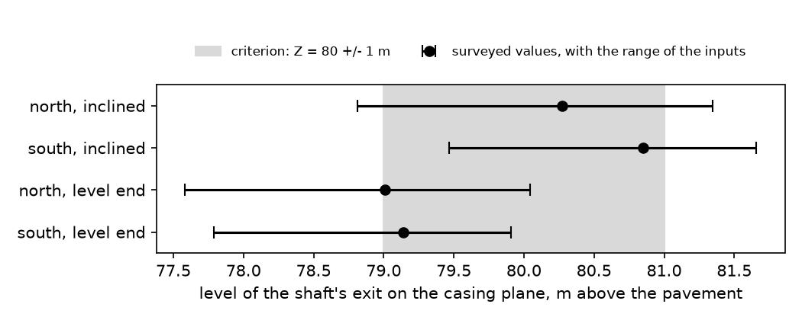

| Claim | Statement | Status | Basis |
|---|---|---|---|
| S15 | The same suction pulls sulfur dioxide and air from the King's Chamber through the four grooves, past the three slabs, into the antechamber. | conditional | With the slabs down, the duct the claim names from the King's Chamber to the Gallery is the grooves, and the criterion tests them: it fails the blind case and allows the connected one about 0.002 m2. Petrie's depths for the 4 grooves in the south wall run out to between 0.0 and 5.1 mm at the top of the doorway, where the stone is broken away, so a connected duct exists only in the reading that lets them reach the doorway, and the blind reading, which is Petrie's own, has none: the connected area is 0.0021 m2 at most (4 grooves 0.105 m wide) against 0.030 m2 for grooves of the full 71 mm, which the measured taper rules out. The clearance round one slab, 0.018 m2 from the one surviving fragment, is 8 times the grooves at their most, so the grooves would not be the only way past the slabs. |
| E11 | The King's Chamber air shafts ended horizontally at the casing and aim at no stars. | conditional | A level outer end is on record for one shaft only: one survey party of 1837 to 1839, known here through a later citation of its unread plate, drew the last 3.0 m of the southern channel level, in core masonry, while the 1881 survey found the incline continuing to that mouth; the northern outlet was forced open before any survey and its level end is only presumed, and the casing is gone at both, so no survey can show a run through it. Carried to the casing plane at the surveyed slopes, the shafts come out at Z = 80.3 m in the north (78.8 to 81.3 m over the ranges of the inputs) and 80.9 m in the south (79.5 to 81.7 m), and with a level last 3.0 m at 79.0 m (77.6 to 80.0 m) and 79.1 m (77.8 to 79.9 m): 4 of the 4 lie inside the criterion's 80 +/- 1 m at the surveyed values and 0 of the 4 over the whole of their ranges. |
| E12 | The antechamber held three granite slabs and has four grooves on its south wall. | conditional | Petrie's depths for the 4 grooves in the south wall run out to between 0.0 and 5.1 mm at the top of the doorway, where the stone is broken away, so a connected duct exists only in the reading that lets them reach the doorway, and the blind reading, which is Petrie's own, has none: the connected area is 0.0021 m2 at most (4 grooves 0.105 m wide) against 0.030 m2 for grooves of the full 71 mm, which the measured taper rules out. The 3 pairs of slots for the slabs and the 4 grooves themselves are on record. |
| E15 | The south passage of the Subterranean Chamber is a dead end. | pass | The survey record has the south passage end blind in rock, 30.8 m below the pavement, with no opening at its south end: Petrie's stations make it 16.41 m long and his coordinates for its two ends 16.41 m (16.28 to 16.54 m over their stated errors), and a second survey, read on the page, gives the same length and the same blind end. |
| E25 | The Queen's Chamber shafts were closed by 3 to 5 in of limestone and had to be broken into. | pass | The survey record has each Queen's Chamber shaft mouth closed by a plate of the wall stone left uncut until both were cut through in 1872: 127 mm (5.0 in) on one witness, quoted twice at second hand, and Petrie describes the plate without a thickness. The claim's 3 to 5 in is 76 to 127 mm and the ledger carries 76 to 127 mm, so the whole range carried for the record lies within the claimed thickness, read to half an inch either side (a judgement call on 'about'); no source was found for 3 in. |
| E32 | A large void lies above the Grand Gallery, found by muon imaging. | pass | The muon paper of 2017 gives a void at least 30 m long, 0.64 of the Gallery's 46.7 m (0.64 to 0.86 over the 30 to 40 m carried for it), with its centre 14.7 m above the top of the Gallery roof (9.6 to 19.8 m) and its south end within 5 m of the pyramid's centre, over the Gallery in plan. Taking comparable as within a factor of 10 in the one dimension published, the order of magnitude that 01 allows (a judgement call), a published void of comparable size lies above the Gallery (it also holds within a factor of two). The section is inferred from the muon excess and not measured, and shape, inclination and the number of voids are open; the heat-exchanger use is judged separately. |

11 computed quantities. Low and high are the ends over the ledger's ranges where the package varied its inputs; they repeat the value where it ran one case

| Id | Quantity | Value | Low | High | Unit | Formula |
|---|---|---|---|---|---|---|
| premises.kcs_north_exit_z | Level at which the northern King's Chamber shaft meets the casing plane, inclined to the face | 80.3 | 78.8 | 81.3 | m | z = z_mouth + s sin(slope); s = (face distance - level runs) / (cos(slope) + (half / apex) sin(slope)) |
| premises.kcs_south_exit_z | Level at which the southern King's Chamber shaft meets the casing plane, inclined to the face | 80.9 | 79.5 | 81.7 | m | z = z_mouth + s sin(slope); s = (face distance - level runs) / (cos(slope) + (half / apex) sin(slope)) |
| premises.kcs_north_exit_z_level | Level at which the northern King's Chamber shaft meets the casing plane, with a level last stretch | 79 | 77.6 | 80 | m | z = z_mouth + s sin(slope); s = (face distance - level runs) / (cos(slope) + (half / apex) sin(slope)) |
| premises.kcs_south_exit_z_level | Level at which the southern King's Chamber shaft meets the casing plane, with a level last stretch | 79.1 | 77.8 | 79.9 | m | z = z_mouth + s sin(slope); s = (face distance - level runs) / (cos(slope) + (half / apex) sin(slope)) |
| premises.groove_connected_area | Largest connected area of the antechamber grooves at the door top | 0.00214 | 0 | 0.00214 | m2 | A = grooves x width x residual depth |
| premises.groove_full_area | Area of the antechamber grooves at their full measured depth | 0.0299 | 0.0299 | 0.0299 | m2 | A = grooves x width x depth |
| premises.slab_clearance_area | Clearance round one portcullis slab | 0.0182 | 0.0182 | 0.0182 | m2 | A = (slot width - slab thickness) x slab width |
| premises.sp_length_between_ends | South passage, distance between its surveyed ends | 16.4 | 16.3 | 16.5 | m | L = |south end - north end| |
| premises.qcs_stone_left | Uncut wall stone at each Queen's Chamber shaft mouth, as recorded | 0.127 | 0.0762 | 0.127 | m | t = the thickness in the survey record |
| premises.void_length_ratio | Big Void length over the Grand Gallery's | 0.642 | 0.642 | 0.857 | 1 | L_void / L_gallery |
| premises.void_centre_above_roof | Big Void centre above the top of the Gallery roof | 14.7 | 9.64 | 19.8 | m | z_void - z_roof |

6 modelling assumptions

- A King's Chamber shaft is a level run from the chamber wall, one straight incline at the surveyed mean slope and, in the level-end reading, a level last stretch, met with the plane of the original casing.
- The two readings of a disputed feature (the level outer end of the southern shaft, the grooves reaching the doorway) are the two ends of the three-way rule; the reading of the direct survey is the unfavourable end.
- An antechamber groove is rectangular at its residual depth, which overstates a half-round groove.
- The clearance round a portcullis slab is the slot width less the thickness of the one surviving fragment.
- Comparable size for the Big Void is tested on its length, the only dimension the muon paper states, within a factor of ten; the assumed section and volume carried in the ledger decide nothing.
- About 3 to 5 in is read to half an inch either side, the precision of a figure quoted in whole inches.

## Documentary checks: what the research files found in the sources

27 claims: 2 pass, 8 fail, 7 conditional, 5 undefined, 5 not testable.

| Claim | Statement | Status | Basis |
|---|---|---|---|
| S02 | Hydrogen sulfide is turned into sulfur dioxide in three unnamed steps inside the satellite pyramids. | undefined | Not specified by the hypothesis: the transcripts assign the conversion of hydrogen sulfide to sulfur dioxide to three steps in the satellite pyramids and name none of them, so no mass balance can be written, and the criterion holds the claim undefined until they are named. The patent cited for three steps covers the whole route from hydrogen sulfide to sulfuric acid, not this conversion. |
| S05 | Operators wait for a storm, warned by wind-driven whistle formations in the western field. | not_testable | No test exists: the criterion holds this as a documented constraint with no computed verdict. Nothing about the formations was found outside the speaker's own videos: no location, no dimensions and no acoustic measurement. |
| S26 | All the liquid, water and product, is withdrawn through the Queen's Chamber; route, driver and destination are not stated. | undefined | Not specified by the hypothesis: the transcripts name no outlet, no driver and no destination for the liquid said to leave through the Queen's Chamber, and the criterion holds the claim undefined until they are named. The chamber's two shafts were closed at the chamber by about 127 mm of uncut wall stone until 1872, and the southern one is closed again by a slab 63.6 m up, so they are dead-end ducts; no other outlet is surveyed. |
| E02 | That paper's X-ray fluorescence analyses found metal compounds matching samples from the plateau's iron deposits. | fail | No evidence found: both datasets were read in full and they do not match. The cited paper analysed one sulfate nodule and one host mudstone by X-ray fluorescence; of the ten elements the speaker names for the iron deposits it reports four, all common trace elements, and none of cerium, neodymium, silver, gold, platinum or tin. The iron-deposit data are 16 samples from Khafre's boat pits, in a report that is not peer-reviewed. The one level the files give for both, thorium, is 139 ppm in the paper's nodule and 0.25 to 1.36 ppm in the pit samples. The research file calls the claim weak. |
| E03 | Cited paper: caves can form in iron-ore bodies, as at the Tomb of the Birds. | fail | No evidence found: no survey of a Giza cave shows cave forms cut in iron ore. The one study of Giza cave deposits that was read in full describes a mudstone exposure on the west side of the plateau and reports iron and manganese oxide as a minor part of gypsum and fracture fills (0.65 and 6.19 percent iron oxide by weight in its two samples), and the research file finds no ore body documented at Giza: the plateau is carbonate rock with minor oxide fills. That exposure is not the Tomb of the Birds, of which no survey was found. The paper the claim cites concerns iron-ore caves at other sites, which the criterion sets aside, and no research file opened it. |
| E04 | Rock forms near the trial passages and the Tomb of the Birds look like Austrian sulfuric-acid caves. | conditional | Partly supported: mineral evidence of sulfuric-acid cave formation is published for the plateau, but not for the sites named. One paper, read in full, argues it from natroalunite, replacive gypsum and related minerals at a single exposure at Darb El Fayum on the west side, in a mudstone unit it lists apart from the formation the pyramids stand on. That exposure is not the trial passages, the Tomb of the Birds or any cave the speaker names, and no sulfur isotopes were measured. Likeness in photographs is not evidence. |
| E05 | Cited paper: a planned off-world sulfuric-acid process for metal extraction mirrors the pyramid's purpose. | not_testable | No test exists: the claim is an analogy between a planned off-world sulfuric-acid process and the pyramid, which the criterion records without a test. No research file opened the cited paper, so nothing is asserted here about what it says. |
| E06 | Ancient Egyptians mined native sulfur at sites near the Suez Canal. | undefined | No evidence found: the transcripts call sulfur mining near the Suez Canal well documented but attribute it to no source and garble the place names, so there is nothing to check, and the research files hold no dated archaeological source for Old Kingdom sulfur mining. The claim belongs to the sulfur-burning version of the hypothesis, which the speaker has replaced. |
| E07 | Cited patent: sulfuric acid can be made from hydrogen sulfide in three steps with a heat exchanger. | fail | Contradicted: the patent does describe three steps with heat exchangers, but none of them can run as the hypothesis needs. Its claims were re-read at source (US 9,108,846): the first step burns hydrogen sulfide at 900 C or more, or oxidises it over a catalyst from 200 C; the second runs at 390 to 430 C over a vanadium catalyst; the third cools the gas to 60 to 120 C. No step runs at ambient temperature without a catalyst, and the hypothesis supplies neither heat nor catalyst. The three steps are the whole route from hydrogen sulfide to acid, not three stages of making sulfur dioxide. |
| E08 | A hole in the King's Chamber floor beside the box existed before excavators dug it further, found debris and gave up. | fail | No evidence found: no source opened, of any date, describes an original lined shaft in the King's Chamber floor. Petrie's survey records only that the floor had been dug under at its west end, below the coffer, which is an excavation in masonry about 43 m above the ground. The research files name no survey older than that digging which records a shaft; the hole is known from the speaker's photographs and a video. |
| E09 | That hole connected to the satellite pyramids; the speaker concedes this is not known. | fail | No evidence found: no conduit is surveyed between the ground and the King's Chamber floor, which lies about 43 m above the pavement in masonry. The only feature recorded under the floor is the excavation at its west end, and the speaker himself says the connection is not known. |
| E10 | The King's Chamber air shafts were blocked, and air flowed once they were cleared. | pass | Supported: for the southern shaft. Vyse's narrative of 1837 has a large stone removed from the southern channel about 7 ft inside the surface on 29 May, after which air rushed into the chamber. It was read as OCR text by one route; a paper of 1964, read on the page, reports the same. The northern channel had already been forced open, so the record covers one shaft, which is what the criterion asks for. |
| E16 | One-way valves sat at the base of the shaft, after a drawing by an unnamed German engineering team. | fail | No evidence found: the surveys of the Subterranean Chamber and its pit that were read record no valve seat, hinge socket, fitting or valve part, and the drawing by a German engineering team that the claim rests on could not be identified. |
| E23 | The speaker's earlier hypothesis: the Serapeum boxes worked as field-driven ultrasound transducers. | not_testable | No test exists: the claim is the speaker's own earlier hypothesis about the Serapeum boxes, an analogy that the criterion records without a test in this project. The research files did not assess the Serapeum. |
| E24 | Whistle-like rock formations in the western field signalled wind changes. | not_testable | No test exists: the criterion holds this as a documented constraint with no computed verdict. The formations are known only from the speaker's own site videos; no location, dimensions or acoustic measurement was found, so there is no geometry to model. |
| E26 | Salt from the Queen's Chamber was analysed in 1978 and held calcium carbonate, sodium chloride and calcium sulfate. | pass | Supported: a letter of 27 November 1978 from the Arizona Bureau of Geology and Mineral Technology (sample no. 56411) ranks the sample as mostly calcite with some halite and gypsum, which are the three phases named. The letter was read as OCR text of its reproduction in a later book. It is qualitative: it gives no method, no quantities, no sampler and no sampling position. |
| E27 | No calcium chloride was found, so no hydrochloric acid was present there. | fail | No evidence found: nothing that the acid model predicts and the salt model cannot has been found, and the example the criterion names is the opposite of what was read. Sodium chloride is present in the Queen's Chamber, which the hypothesis fills: the 1978 letter lists some halite, and a laboratory study of 2026, read by two routes, identifies the efflorescence there as halite. No height-resolved salt map exists. The research file calls the inference from missing calcium chloride weak, since calcium chloride takes up water from the air and would not last as a crust (general knowledge there, not sourced). |
| E28 | Calcium sulfate covers the Grand Gallery walls. | conditional | Partly supported: a salt crust on the Grand Gallery walls is documented for the 1990s, when twelve months were spent cleaning it off in 1998, but its composition was never published, an account of 1910 records no salt in the Gallery, and Petrie does not describe its walls. A crust limit at one level in the Queen's Chamber and the Gallery, which the criterion asks for, has not been looked for: no height-resolved salt map exists. The one height-resolved datum, Petrie's note that the two lower laps of the Queen's Chamber niche were salted and the three upper ones not, is not what a complete fill predicts, and the study of 2026 found no gypsum crust in that chamber. |
| E30 | Small pits all over the Queen's Chamber walls record repeated loss and re-forming of that coat. | conditional | No evidence found: no published description or survey of pitting in the Queen's Chamber was found. Petrie and the Edgars describe salt incrustation and fine joints there, not pits, and the pits are the speaker's own observation. The test the criterion names, which tells a gypsum rind on etched calcite from efflorescence on tooled stone, has not been made: the study of 2026 sampled efflorescence and loose material only, and found halite and no gypsum crust. Pitting is a normal result of salt crystallising in porous limestone. |
| E31 | The slab at the end of the Queen's Chamber south shaft is Tura limestone with copper pins, and Tura limestone has much more quartz than the local bedrock. | undefined | No evidence found: the quartz claim is attributed to no source, and the research files found no matched mineralogy of Tura limestone and Giza bedrock. The one compositional source opened, an author's summary of a study of 1984, pools six Tura and Mokattam quarry sites at 0.5 to 2.5 percent quartz and 96 to 99 percent calcite, which cannot show one richer than the other. That the slab is Tura limestone and its pins copper are judgements by eye, from polish and colour; neither was assayed. |
| E33 | Sodium chloride deposits cover the inside of the central pyramid's main chamber. | conditional | Partly supported: salt is documented in Khafre's burial chamber, but no analysis of it was found. Salt residue was cleaned from the chamber walls in 2003 to 2004, on a news report that was not re-checked, and Petrie, re-read at source, noted a good deal of crystallised salt inside the coffer. Sodium chloride is plausible, since halite is native to the bedrock the chamber is cut in, and for the same reason it would not show an acid process. |
| E34 | Chemical analysis shows catalyst material inside the Red Pyramid. | undefined | No evidence found: no analysis is attributed in the transcripts, so there is no source to check, and the research files hold none. The research file lists the Red Pyramid's claimed function as not assessed, with no evidence found in its domain. |
| E35 | Cited article: the iron veins may be lightning vitrification or hydrothermal mineralisation, and the Sphinx stela records lightning striking the plateau. | conditional | Partly supported: the cited article does say both things, but neither condition of the criterion is met in full. The article, read in full, calls the features veins of vitrification, grants that iron-rich hydrothermal deposits may occur as well, and reports no sampling and no analysis, so there are no laboratory data for vitrified vein material; nobody has published that analysis. The lightning is in the Inventory Stela, an object of the 26th Dynasty: the translations attributed to Maspero and to Daressy have one great tree struck at the Place of the Sycamore, in an abraded passage whose reading is doubted, and Breasted's partial translation has no lightning at all. All three were seen as quoted on secondary pages, not in a primary edition. The passage records one strike, not how often lightning struck. |
| E36 | Vein samples show a hydrothermal origin, fulgurites and silica microspheres show high-voltage current, and many metals including rare earths are present. | fail | No evidence found: the sample analyses were located and read in full, and they do not report what the claim says. The report, by an independent group and not peer-reviewed, covers 16 samples of iron-stained material from four of Khafre's boat pits and one control sample, not veins across the plateau, and it has no word for fulgurite, glass or sphere. Lanthanum, cerium and neodymium exceed the control in 3, 4 and 5 of the 16 samples, with medians about half the control, and thorium is below it in all 16; nickel, cobalt, vanadium, zinc and uranium are above it, as is usual for iron and manganese oxide fills. No fulgurite, vitrified rock or microspherule from Giza is documented in any source found. |
| E37 | Iron veins occur in the Osiris Shaft second level, in the Great Pyramid's subterranean shaft and in the central pyramid's bedrock chamber. | conditional | No evidence found: no four-point measurement along a Giza vein has been made, so the test the criterion names cannot be applied. Measured dry hematite spans the whole range: earthy red material is more resistive than the limestone, and the best specular sample gives a contrast of about 3e4 in 100 ohm m rock, above the criterion's fail line of 1e3 and below the 2.7e5 derived for a 100 m link. Observers describe the Giza fills as red, ochreous or dull black, the resistive end. Veins in the Osiris Shaft are reported from personal observation, and those in the two pyramids rest on the speaker's photographs. The research file expects a fail and says a measurement is needed. |
| E39 | Boat pits by the Great Pyramid hold only sulfate compounds and those by the central pyramid only chloride compounds; channels lead into the pits. | conditional | Partly supported: chloride in Khafre's pits is supported, exclusivity is not, and the test the criterion names has not been made. The analyses behind the claim, an independent group's report that is not peer-reviewed and was read in full, cover Khafre's pits only: chlorine reaches 26.7 percent by weight, with gypsum named in almost every phase description, barite and celestine imaged and sulfur up to 5 percent, so chloride only is contradicted there. No analysis of Khufu's pits was found. No survey of the pit walls for retreat, gypsum crust or tool marks was found, which is what the criterion asks for. Khufu's two southern pits were found sealed over dismantled boats, on secondary accounts. |
| E40 | An underground shaft joins the Great Pyramid to the Sphinx enclosure, on the word of an unnamed ministry contact. | not_testable | No test exists: the criterion holds this as a documented constraint with no computed verdict. The basis is an unnamed acquaintance speaking on a tour. No survey, excavation report or publication describing such a tunnel was found, and the cavities known at the Sphinx are a few metres long, on secondary pages that were not opened. |

4 modelling assumptions

- The research files in research/ are the evidence base; no source outside them was consulted.
- A documentary status follows the ruling of the simulations design, section 2: pass when a source the research files read meets the criterion, fail when a source that would show it was read and does not or contradicts it, conditional when it is partly met or rests on a secondary source or on a measurement nobody has made, undefined when the claim names no source that could be checked or the hypothesis leaves the matter unspecified.
- Where a criterion joins two conditions with 'and', both must hold for a pass.
- A claim whose own criterion says that nothing can decide it is not_testable; its basis records what was found.

## Water and gas movement: reduced hydraulic and gas-network models

5 claims: 1 fail, 4 conditional.

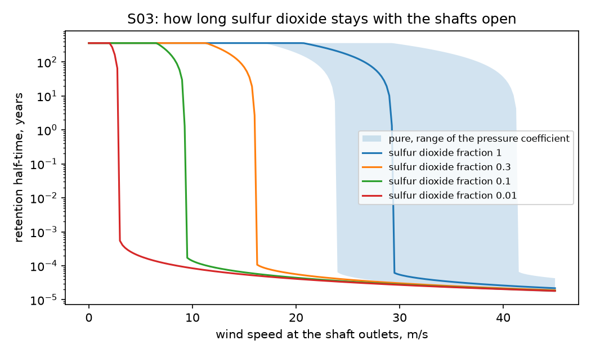

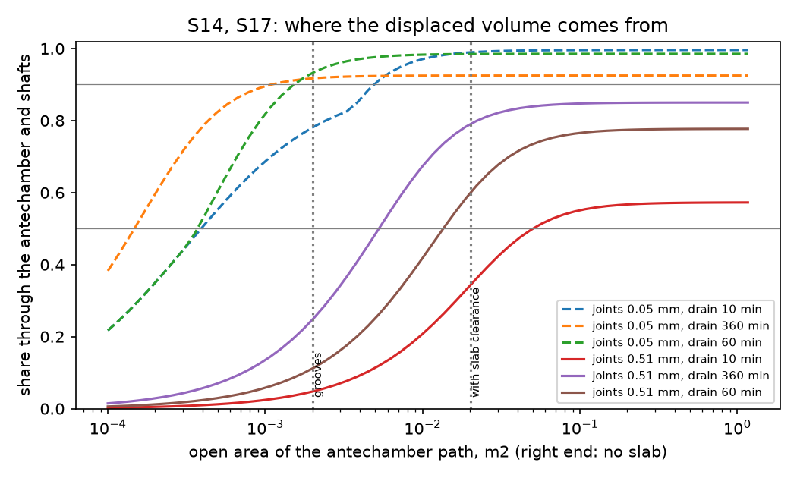

| Claim | Statement | Status | Basis |
|---|---|---|---|
| S03 | Sulfur dioxide travels up a shaft from below, enters by a floor opening beside the granite box and fills the King's Chamber. | conditional | With its shafts open a King's Chamber of pure sulfur dioxide loses half its charge by diffusion in 361 (271 to 460) years, and no wind below 29 (23 to 43) m/s can drive a through-flow, because the gas, 2.2 times as dense as air, would have to be lifted up the leeward shaft against 516 (472 to 551) Pa. The same weight carries it out of an opening at the chamber's floor while no water stands beyond it and the Gallery is open to the air, which the hypothesis does not say for the time before the fill: through the 202 cm2 of grooves and one slab's clearance in the antechamber, the gas path of the hypothesis, half the charge is gone in about 69 minutes (41 at the fastest, never with the path shut). In the 30 m/s at the top of the assumed wind range the half-time falls to 15 minutes, and to 11 with the floor opening draining at its fastest as well, against the interval between delivery and draw, which the hypothesis does not state and which is taken as 10 minutes to 30 days; a charge diluted to a tenth is held only below 9 m/s, and below the wind that lifts it the model loses gas up the shafts by diffusion alone, which is a limit of the model. Remaining is read as half the charge still being there at the draw, and the hypothesis states neither the composition of the charge nor what keeps it in. |
| S08 | Water from the external reservoir is let into the Subterranean Chamber; the inlet is not described. | conditional | The highest water documented at Khufu or beside it, the Old Kingdom flood peak or today's water table, stands 15 (10 to 18) m below the foot of the Descending Passage; the chamber's deepest floor lies 1.9 m and the pit's original bottom up to 5.1 m lower than that foot, still above that water. Perched water at 22 to 48 m above sea level is interpreted from geophysics toward Menkaure and none is reported at Khufu, so it is not counted. No documented water therefore reaches the Subterranean Chamber, and the step holds only for a reservoir that is assumed: the hypothesis names one without level, volume or inlet, and nothing on site attests it. It must stand at pavement level or above and enter by a conduit that no survey shows, or 17.0 m above the pavement to use the entrance, the only surveyed opening; to fill the Gallery by communicating vessels alone it must stand 51.5 m above the pavement, 112 (109 to 114) m above sea level. One fill takes 866 (808 to 924) m3, an inflow of 0.24 m3/s if it takes 1 h, after 385 (284 to 536) m3 to prime the Subterranean Chamber and the Descending Passage up to the pavement. |
| S13 | With the gallery full of water and the King's Chamber full of sulfur dioxide, the gallery level is lowered slowly; the outlet is not stated. | fail | With the Gallery full to its roof the water stands 8.5 (8.3 to 8.6) m above the antechamber floor and presses with 83 kPa, so an opening that passes gas passes water: past slabs as loose as the surviving fragment 0.16 (0.14 to 0.26) m3/s enter and the water stands at the King's Chamber shaft mouths after 6 (4 to 7) minutes, through the 20 cm2 of the grooves alone after 1.0 h, and with the path shut no gas passes either. Holding the water back would take 83 kPa of gas pressure, which the open shafts release in 53 s, and with the shafts shut the water still rises 2.2 m or more in the chamber. Water stays out only if the fill stops at the antechamber floor, 43.0 m above the pavement, and the hypothesis states no drain route. |
| S14 | The falling water draws outside air down the King's Chamber shafts into the chamber. | conditional | The antechamber opening lies 7.4 m under the surface of the full Gallery, and until 13.2 (12.7 to 13.3) percent of the Gallery has drained gas enters it only where the suction exceeds the water standing over it, 72 kPa at the start. Draining the Gallery in 1 h through 202 cm2 of grooves and one slab's clearance, with masonry joints of 0.51 mm leaking along a path of 1.0 m, 60 percent of the replacement gas comes down the King's Chamber shafts; the pressure difference is 195 Pa at the start, when the joints alone supply the pocket, and 60 Pa once the opening is clear. Over drain times of 10 minutes to 6 h, joints of 0.05 to 0.51 mm and joint paths of 0.3 to 3.0 m the share runs from 20 to 100 percent with that path open, and from 0 percent if the path is shut, as blind grooves and seated slabs would leave it; the pressure difference runs from 1 Pa to 99 kPa, the most a water column can pull. Through the grooves alone the share is 11 percent, through the three slabs' clearances one after another, which pass what 108 cm2 passes, 44 percent, and with no slab in the passage 78 percent. More than half comes down the shafts with the joints tighter than 0.64 mm, or the drain slower than 30 minutes; the hypothesis states neither a drain rate nor how the Gallery is made gas-tight. |
| S17 | Sulfur trioxide, leftover sulfur dioxide and air pass on into the gas space of the Grand Gallery above the falling water. | conditional | Of the Gallery's five surveyed openings the Ascending Passage, the Queen's passage and the well shaft meet it at its foot and stay under water until 0.7 percent of it or less is left, and Davison's passage ends in a closed chamber. The antechamber opening lies 7.4 m under the surface of the full Gallery, and until 13.2 (12.7 to 13.3) percent of the Gallery has drained gas enters it only where the suction exceeds the water standing over it, 72 kPa at the start. With gas-tight masonry nothing else can enter, so 100.0 (99.9 to 100.0) percent of the displaced volume is drawn through the antechamber passage as surveyed, with no slab in it. Counting gas that leaks in through 1350 m of masonry joints of 0.05 to 0.51 mm, from air-filled masonry at outside pressure 0.3 to 3.0 m behind the Gallery's face, a leak that is assumed and that 01 leaves open for the syringe, the share is 78 (38 to 100) percent over drain times of 10 minutes to 6 h and passes 90 percent with joints tighter than 0.11 (0.04 to 0.24) mm or somewhat wider, the model letting neither the pocket's gas thin nor Davison's chamber lend. With the slabs of the hypothesis down the two shares are 100.0 and 60 percent through 202 cm2 of grooves and one slab's clearance, and nothing if that path is shut, which is the question of S15. |

27 computed quantities. Low and high are the ends over the ledger's ranges where the package varied its inputs; they repeat the value where it ran one case

| Id | Quantity | Value | Low | High | Unit | Formula |
|---|---|---|---|---|---|---|
| flow.submerged_share | Share of the Gallery displaced before the falling water surface reaches the top of the antechamber opening | 0.132 | 0.127 | 0.133 | 1 | share = integral of w(y) (y - h0) dy / (tan(a) S l_floor cos(a)); h0 = z_antechamber_floor + h_passage - z_floor_south; S = slot + lower wall + seven laps of width w(y) |
| flow.draw_pressure | Pressure of the Gallery's gas space below the outside air once the antechamber opening is clear of the water, joints leaking | 60.4 | 1.11 | 9.9e+04 | Pa | dp solves C sqrt(2 dp / rho) + l_joints b^3 dp / (12 mu l_path) = V_gallery / t_drain; 1/C^2 = 1/(Cd a)^2 + 1/(A_n / sqrt(K_n) + A_s / sqrt(K_s))^2; a = a_grooves + a_slab_leak |
| flow.start_pressure | Pressure of the Gallery's gas space below the outside air at the start of the draw, the antechamber opening under water, joints leaking | 195 | 8.94 | 9.9e+04 | Pa | dp solves C sqrt(2 max(0, dp - rho_water g d) / rho) + l_joints b^3 dp / (12 mu l_path) = V_gallery / t_drain; d = z_floor_south + h_gallery - z_antechamber_floor - h_passage; dp stops at p_atm - p_vapour |
| flow.shaft_share | Share of the displaced volume that comes down the King's Chamber shafts and through the antechamber, joints leaking | 0.6 | 0 | 0.997 | 1 | share = sum over the water levels of dV Q_antechamber / (Q_antechamber + Q_joints), less the gas given up by Davison's chamber; Q_antechamber = C sqrt(2 max(0, dp - rho_water g d) / rho) while the water stands d over the opening's top |
| flow.antechamber_share | Share of the displaced volume drawn through the antechamber passage as surveyed, the masonry gas-tight | 1 | 0.999 | 1 | 1 | share = 1 - V_davison dp / (p_atm V_gallery); a = w_passage h_passage; the three openings at the Gallery's foot are under water, and gas enters the antechamber opening against the water over it |
| flow.slabs_absent_share | Share drawn through the antechamber passage as surveyed, joints leaking | 0.777 | 0.378 | 0.998 | 1 | as flow.shaft_share with a = w_passage h_passage |
| flow.slabs_down_share | Share drawn through the antechamber path with the slabs down, the masonry gas-tight | 1 | 0 | 1 | 1 | share = 1 - V_davison dp / (p_atm V_gallery) if the path is open, else 0; a = a_grooves + a_slab_leak |
| flow.joint_aperture_half | Joint aperture at which half the displaced volume still comes down the shafts, the slabs down | 0.000637 | 0 | 0.00218 | m | b at which flow.shaft_share is 1/2 before the gas from Davison's chamber is taken off; found by bisection, the share falling as the joints open |
| flow.joint_aperture_nine_tenths | Joint aperture at which nine tenths of the displaced volume still passes the antechamber passage as surveyed | 0.000113 | 4.1e-05 | 0.000243 | m | b at which flow.slabs_absent_share is 9/10 before the gas from Davison's chamber is taken off; found by bisection, the share falling as the joints open; a = w_passage h_passage |
| flow.foot_seal_depth | Depth of water over the Gallery's foot openings that the draw's suction could hold up once the antechamber opening is clear | 0.00617 | 0.000114 | 10.1 | m | d = dp / (rho_water g): gas can rise through a foot opening only under less water than this |
| flow.foot_wedge_share | Share of the Gallery's volume below the tops of the three openings at its foot, at most | 0.00662 | 0.00599 | 0.00738 | 1 | share < (d^2 / (2 tan(a))) w / V_gallery; d = the tallest foot opening's top above the Gallery's lowest point |
| flow.documented_water_below_chamber | Depth of the highest documented water below the foot of the Descending Passage | 15 | 10.5 | 17.5 | m | gap = z_base_asl + z_passage_end - max(z_flood_peak_asl, z_water_table_asl); positive means no water arrives |
| flow.reservoir_level_vessels | Level above sea level that a reservoir must hold to fill the Gallery by communicating vessels alone | 112 | 109 | 114 | m | z_asl = z_base_asl + z_gallery_roof |
| flow.fill_volume | Water one fill takes: the Gallery, the Queen's Chamber and its passage, the Ascending Passage and the well shaft | 866 | 808 | 924 | m3 | V = V_gallery + V_queens + V_niche + V_queens_passage + V_ascending + V_well_shaft |
| flow.prime_volume | Water that first fills the Subterranean Chamber and the Descending Passage up to pavement level | 385 | 284 | 536 | m3 | V = V_chamber + (-z_passage_end / sin(a)) w h |
| flow.fill_inflow | Inflow that delivers one fill in the fill time | 0.24 | 0.00935 | 1.54 | m3/s | Q = V_fill / t_fill |
| flow.antechamber_water_head | Height of the water above the antechamber floor with the Gallery full to its roof | 8.51 | 8.34 | 8.57 | m | h = z_gallery_roof - z_antechamber_floor |
| flow.kc_holdback_pressure | Gas pressure in the King's Chamber that would hold the water of a full Gallery back | 8.33e+04 | 8.17e+04 | 8.41e+04 | Pa | p = rho g (z_gallery_roof - z_antechamber_floor), above the outside air |
| flow.kc_ingress_rate | Water entering towards the King's Chamber past slabs as loose as the surviving fragment, the Gallery full | 0.159 | 0.139 | 0.261 | m3/s | Q = Cd (c_slab w_slab + a_grooves) sqrt(2 g h) |
| flow.kc_flood_time | Time for water to stand at the King's Chamber shaft mouths, slabs as loose as the surviving fragment | 370 | 224 | 422 | s | t = (2 A / (Cd a sqrt(2 g))) (sqrt(H) - sqrt(H - d)); H = z_gallery_roof - z_kc_floor; d = mouth height |
| flow.kc_gaslock_depth | Least depth of water in the King's Chamber if its shafts were shut and its gas were compressed instead | 2.21 | 2.16 | 2.24 | m | p_atm H_kc / (H_kc - d) = p_atm + rho g (H - d), solved for d; H = z_gallery_roof - z_kc_floor |
| flow.kc_vent_time | Time for the open shafts to pass one chamber volume of sulfur dioxide under the hold-back pressure | 52.6 | 50 | 55.1 | s | t = V_kc / ((A_n / sqrt(K_n) + A_s / sqrt(K_s)) sqrt(2 p / rho_so2)) |
| flow.so2_density_ratio | Density of sulfur dioxide against air | 2.21 | 2.14 | 2.26 | 1 | ratio = (p M / (R T)) / rho_air |
| flow.dense_gas_head | Pressure difference needed to lift pure sulfur dioxide up a King's Chamber shaft to its outlet | 516 | 472 | 551 | Pa | B = (rho_so2 - rho_air) g (z_outlet - z_kc_floor - h_mouth) |
| flow.flush_wind_speed | Wind speed below which no through-flow can lift a chamber of pure sulfur dioxide out | 29.3 | 22.9 | 42.9 | m/s | U = sqrt(2 B / (dCp rho_air)) |
| flow.diffusion_half_time | Time for half the sulfur dioxide to leave the King's Chamber by diffusion up its two shafts | 1.14e+10 | 8.55e+09 | 1.45e+10 | s | t = ln(2) V_kc / (D (A_n / L_n + A_s / L_s)) |
| flow.retention_half_time | Time for half of a chamber of pure sulfur dioxide to leave by diffusion and wind-driven through-flow | 1.14e+10 | 904 | 1.45e+10 | s | dy/dt = -y (Q / V_kc + 1 / tau); S Q^2 = dCp rho_air U^2 / 2 - B y; S = (rho_air / 2) (K_n / A_n^2 + K_s / A_s^2) |

10 modelling assumptions

- Water moves through an opening by the orifice law, Q = Cd a sqrt(2 g h); vessels are prismatic.
- "The Gallery filled" means filled to its roof, as S12 and S13 say; the peak level is not otherwise stated.
- An opening below the falling water surface carries water, not gas. The Ascending Passage, the Queen's passage and the well shaft all meet the Gallery at its foot, so they stay covered until the Gallery is all but empty.
- The antechamber opening lies under the full Gallery's surface too: until the surface has fallen to the opening's top, gas enters there only by the suction in excess of the water standing over it, and from then on freely. The Gallery is its surveyed section carried along the slope; the water that enters the antechamber meanwhile is S13's matter.
- The antechamber path with the slabs down is one opening, the grooves plus the leak round one slab though three stand one after another, in series with the two King's Chamber shafts; the King's Chamber itself is gas-tight apart from these.
- Gas is incompressible air at the ledger's density, moving at a steady rate, the Gallery volume over the drain time; the suction is capped at what a hanging water column can apply (02 section 4.4).
- Masonry joints leak gas as laminar slots, over their whole length from the start of the draw, from air-filled masonry at outside pressure; a gas-tight Gallery is what the tight end of the joint aperture approaches.
- The chamber behind Davison's passage is closed and only gives up the gas its pressure drop releases; what it lends while the suction is high and takes back later is left out.
- Sulfur dioxide fills the King's Chamber pure, as S03 and S13 say, and is well mixed; it leaves by diffusion up the shafts and by a wind-driven through-flow that must lift the dense gas up the leeward shaft. Gusts, the breathing of the chamber with the barometer and temperature differences are not modelled.
- The same charge runs out by its own weight through an opening at the chamber's floor that has no water beyond it, under the head of the gas below the shaft mouths, where the air comes in. S03 counts this for the antechamber path, as an unmixed layer, with the Gallery open to the air; the floor inlet by which the gas arrives is taken as closed, which the hypothesis does not say. With the Gallery closed only an exchange through the one opening is left, hours to more than a day; with water over the opening nothing drains, and S13's water pushes out at most the 16 percent of the charge below the shaft mouths.

## Chemistry and feed: gas transfer, oxidation, wall attack and the feed

5 claims: 1 fail, 2 conditional, 2 undefined.

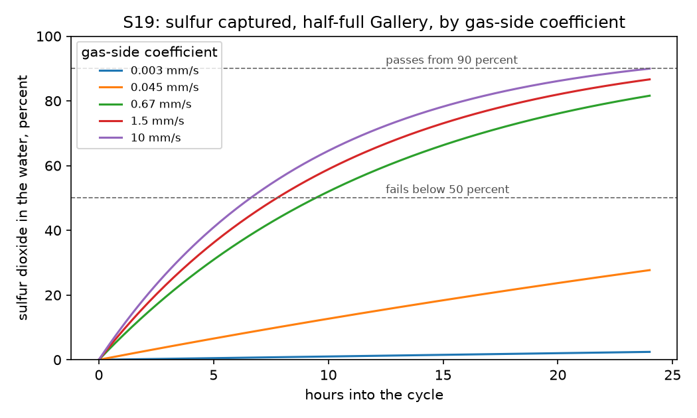

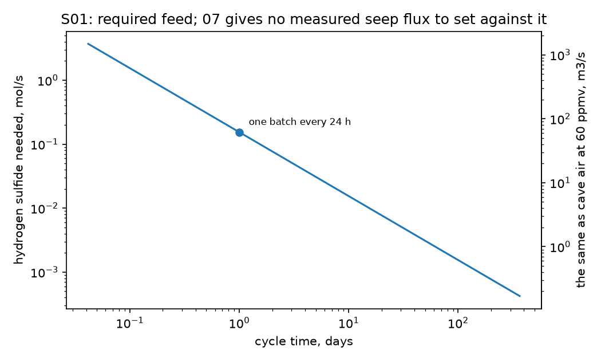

| Claim | Statement | Status | Basis |
|---|---|---|---|
| S01 | Hydrogen sulfide rises from natural caves, tunnels and old vent features under the plateau. | undefined | One full batch needs 13319 mol of hydrogen sulfide, 454 kg, a mole for each mole of sulfur dioxide in the King's Chamber, which is 0.15 mol/s and 166 t a year at one batch every 24 h, and 0.00041 to 3.8 mol/s over the cycle times taken; the hypothesis states no cycle rate, so the required flux is undefined (07 section 4.4). 07 gives no flux for any seep or spring to set against it: its one analogue is a concentration, read from an abstract, at which one batch is the sulfide in 5.3 million m3 of cave air (60 ppmv in active sulfuric-acid caves). |
| S19 | Leftover sulfur dioxide dissolves in the water to give sulfurous acid. | conditional | With the Gallery half full and a cycle of 24 h (the hypothesis states none; 1 h to 1 yr is taken as its range), 87 percent of the sulfur dioxide crosses the level surface into the water (0.1 to 97 percent over the ranges of the inputs), which over those ranges is neither always at the 90 percent from which the criterion passes the claim nor always under the 50 percent below which it fails it. The water could hold 98 percent at equilibrium, so the rate decides. It depends on the cycle time, on whether the gas over the water stands still or convects (gas-side coefficient 0.003 to 10 mm/s, assumed) and on the film on the water's side of the surface (liquid-film coefficient 0.001 to 0.01 mm/s, assumed with no source), none of which the hypothesis gives; the 87 percent is for a gas-side coefficient of 1.5 mm/s and a liquid-film coefficient of 0.01 mm/s. |
| S22 | No gas is pushed back into the King's Chamber, because both gases dissolve as fast as the water rises. | fail | A full stroke draws 573 m3 of gas into the Gallery and the King's Chamber holds 320 m3, so at least 44 percent of the gas over the water is the outside air of S14 (39 percent at the least). Its nitrogen hardly dissolves: if all the sulfur dioxide dissolved, the oxidation used every mole of oxygen it could and the water arrived free of dissolved gas, the rising water would still push 33 percent of the gas back (29 to 37 percent over the ranges of the inputs), and 54 percent of a mixture that carries the oxygen for all its sulfur. Nothing is pushed back only if air is under 2.0 percent of the gas (2.4 percent at most), which brings oxygen for 0.8 percent of the sulfur, while S14 to S17 carry air into the Gallery; the hypothesis states no gas fraction and no stroke. Taking the least air of a full stroke, not a gas without air, as the end most favourable to the hypothesis is a judgement call. |
| S23 | Acid attacks the limestone walls of the gallery and Queen's Chamber, forming a calcium sulfate layer that stops further attack and re-forms where it chips off. | conditional | Fresh water lets bare limestone neutralise 41 percent of the strongest batch before gypsum can form (Tier 0), and the layer that then grows by acid diffusing through it reaches 3.7 micrometres in a cycle of 24 h (the hypothesis states none; 1 h to 1 yr is taken as its range) (0.1 to 74 micrometres over the ranges of the inputs). One fill of fresh water can dissolve 0.63 mm of gypsum, 173 times that layer (7.7 times at the least); even the most gypsum a whole batch can lay down is 55 percent of what one fill dissolves (76 percent at most), so a fill that comes to saturation strips it; every cycle then starts on bare stone, which loses up to 0.21 mm per cycle and 2.1 mm in ten in bringing each batch to saturation (1.6 to 4.9 mm over the ranges of the inputs). A fill that stands still strips the layer a bare wall grows in one cycle by diffusion alone only if it stands at least 0.1 times as long as the acid stood (0.19 times at most). The hypothesis does not state that time; over the range taken, 1.9e-05 to 1 of the acid's, a still fill dissolves 0.0099 to 23 times that layer, and 0.65 times at the 0.042 the ledger takes as its value. The acid of the next batch does not strip it: still acid dissolves it from outside while it grows from beneath and leaves at most 49 percent of it (7 to 61 percent), about 26 percent once the batch's bisulfate is counted (4 to 35 percent). So whether the layer lasts depends on how long the fresh water stands against the wall and on how it moves, neither of which the hypothesis states. |
| E01 | Cited paper: hydrogen sulfide rises under the Giza plateau, tied to hydrocarbon seepage and sulfuric-acid cave formation. | undefined | No opened source gives a measured hydrogen sulfide flux, composition or source pressure under the plateau: 07 read the cited paper in full, and it measured no gas and reports no present-day seepage, so the passing clause is not met. The failing clause cannot be evaluated either: one full batch needs 13319 mol of hydrogen sulfide, 454 kg, a mole for each mole of sulfur dioxide in the King's Chamber, which is 0.15 mol/s and 166 t a year at one batch every 24 h, and 0.00041 to 3.8 mol/s over the cycle times taken; the hypothesis states no cycle rate, so the required flux is undefined (07 section 4.4). 07 gives no flux for any seep or spring to set against it: its one analogue is a concentration, read from an abstract, at which one batch is the sulfide in 5.3 million m3 of cave air. |

25 computed quantities. Low and high are the ends over the ledger's ranges where the package varied its inputs; they repeat the value where it ran one case

| Id | Quantity | Value | Low | High | Unit | Formula |
|---|---|---|---|---|---|---|
| chem.capture_share | Share of the sulfur dioxide that reaches the water of the half-full Gallery in one cycle | 0.866 | 0.000849 | 0.974 | 1 | y = (1 - exp(-t / tau)) / (1 + 1 / m); tau = V / (2 K A (1 + 1 / m)); 1 / K = 1 / k_g + 1 / (m k_L); m = H R T; A = S / tan(a) |
| chem.capture_equilibrium | Share of the largest batch the water of the half-full Gallery holds at equilibrium | 0.982 | 0.977 | 0.985 | 1 | n_gas / V_gas = a0([H+]) c / (H R T), with [H+] from the charge balance of the dissolved sulfur(IV) |
| chem.uptake_pace | Uptake rate of sulfur dioxide over the rate at which a one-cycle fill displaces the gas | 1.09 | 0.000425 | 612 | 1 | Da = K A t / V_gallery |
| chem.oxidation_half_life | Half-life of dissolved sulfur(IV) under the iron law at the batch's starting pH | 2.13e+04 | 1.9e+03 | 2.36e+06 | s | t = ln 2 / (k [Fe(III)] a2([H+])); oxygen permitting |
| chem.least_air | Least share of air in the gas a full stroke draws into the Gallery | 0.441 | 0.389 | 0.485 | 1 | x = 1 - V_chamber / V_gallery |
| chem.forced_back_least_air | Share of the gas the rising water must push back, with the least air | 0.333 | 0.289 | 0.369 | 1 | f = x_N2 (1 - H_N2 R T) + leftover O2 less what dissolves; all SO2 dissolved, all usable O2 used |
| chem.forced_back_stoichiometric | Share of the gas pushed back for the mixture with oxygen for all its sulfur | 0.541 | 0.538 | 0.543 | 1 | as chem.forced_back_least_air with x_air = 1 - 1 / (1 + 0.5 / x_O2) |
| chem.air_without_pushback | Largest share of air in the gas for which nothing need be pushed back | 0.0197 | 0.0179 | 0.0239 | 1 | x = H_N2 R T / (1 - x_O2) |
| chem.sulfur_oxidisable_without_pushback | Share of the sulfur that the oxygen of that much air can oxidise | 0.00843 | 0.00763 | 0.0103 | 1 | y = x_O2 x / (0.5 (1 - x)) |
| chem.gypsum_layer_per_cycle | Gypsum layer that grows in one cycle on a wall bare at its start | 3.67e-06 | 1.37e-07 | 7.44e-05 | m | d = sqrt(Vm D C t); C = 2 n_SO2 / V_gallery |
| chem.fill_dissolves | Gypsum layer one Gallery of fresh water dissolves in coming to saturation | 0.000634 | 0.000572 | 0.00105 | m | d = s rho V_gallery Vm / A_wall |
| chem.still_fill_dissolves | Gypsum layer a still fill of fresh water dissolves by diffusion alone in its dwell | 2.37e-06 | 7.84e-09 | 0.000299 | m | d = 2 s rho sqrt(D_w f t / pi) Vm; f = fresh dwell over acid dwell |
| chem.saturating_margin | What a saturating fill dissolves over the layer one cycle grows | 173 | 7.73 | 7.62e+03 | 1 | chem.fill_dissolves / chem.gypsum_layer_per_cycle |
| chem.still_margin | What a still fill dissolves over the layer one cycle grows | 0.646 | 0.00992 | 23.1 | 1 | chem.still_fill_dissolves / chem.gypsum_layer_per_cycle; the cycle time cancels, the fresh dwell f does not |
| chem.fresh_dwell_to_strip | Dwell of still fresh water, as a share of the acid's, at which it just dissolves the layer one cycle grows | 0.1 | 0.00187 | 0.193 | 1 | f / chem.still_margin^2; f cancels |
| chem.layer_left_under_acid | Most of a cycle's layer that stands under still acid, which dissolves it outside while it grows beneath: all the batch's sulfate counted as free | 0.491 | 0.074 | 0.61 | 1 | 2 / (r + sqrt(r^2 + 4)); r = 2 x sqrt(D_w t / pi) Vm / chem.gypsum_layer_per_cycle; x (c + x) = (s rho)^2; from dd/dt = Vm D C / (2 d) - x Vm sqrt(D_w / (pi t)) |
| chem.layer_left_counting_bisulfate | Share of a cycle's layer that stands under still acid once the batch's bisulfate is counted | 0.265 | 0.0381 | 0.347 | 1 | as chem.layer_left_under_acid with x from Ka2 = H+ y / HSO4-; y = (s rho)^2 / x, H+ = c - x + y, HSO4- = c + x - y |
| chem.deposit_over_fill | Most gypsum a whole batch can lay down over what one fresh fill dissolves | 0.552 | 0.138 | 0.76 | 1 | max(0, c / (s rho) - 1): (c - s rho) V_gallery over s rho V_gallery |
| chem.wall_loss_per_cycle | Limestone lost in a cycle that starts bare and comes to gypsum saturation | 0.000206 | 0.000162 | 0.00049 | m | w = x c V_gallery Vc / A_wall + d Vc / Vm; x = min(1, (s rho / c)^2) |
| chem.wall_loss_ten_cycles | Limestone lost in ten such cycles, every fill stripping the layer | 0.00206 | 0.00162 | 0.0049 | m | 10 x chem.wall_loss_per_cycle |
| chem.h2s_per_batch | Hydrogen sulfide one full batch needs | 1.33e+04 | 1.28e+04 | 1.36e+04 | mol | n = p V / (R T), a mole for each mole of sulfur dioxide |
| chem.h2s_mass_per_batch | Mass of the hydrogen sulfide one full batch needs | 454 | 437 | 464 | kg | m = n M |
| chem.h2s_flux | Hydrogen sulfide flux for one full batch per cycle | 0.154 | 0.000406 | 3.78 | mol/s | F = n / t |
| chem.h2s_mass_per_year | Hydrogen sulfide for a year of full batches | 1.66e+05 | 437 | 4.07e+06 | kg | m = n M x one year / t |
| chem.cave_air_per_batch | Cave air at the analogue's ceiling that holds the sulfur of one batch | 5.34e+06 | 5.31e+06 | 5.37e+06 | m3 | V = V_chamber / x_H2S |

12 modelling assumptions

- The batch is Tier 0's largest: one King's Chamber of pure sulfur dioxide at one atmosphere per cycle.
- The hypothesis states no cycle time; one day is taken, as Tier 0 does for S20, with a range of one hour to one year.
- S19: the Gallery is half full, the mean of the rise, with mixed gas above mixed water and a gas film and a liquid film in series at the level surface.
- S19: the water takes the undissociated gas in proportion to its pressure; dissociation enters the equilibrium share only, and sulfur dioxide carried out with displaced air is not deducted.
- S19: the gas-side coefficient runs from diffusion through still gas to natural convection; no source gives it.
- S22: a full stroke draws one Gallery volume of gas, of which the King's Chamber can supply only its own volume; the rest is the outside air of S14.
- S22: the rising water is credited with all the sulfur dioxide, every mole of oxygen the oxidation can use, and nitrogen and oxygen up to their solubility in water that arrives free of dissolved gas.
- S23: each cycle starts with fresh water; bare limestone neutralises acid until gypsum saturates, then a layer grows only as fast as acid diffuses through it, with the measured diffusivity of the ledger.
- S23: the fresh water of the next cycle dissolves gypsum up to its solubility if it comes to saturation, and at the least what diffusion alone carries into still water in the time it stands, which the hypothesis does not state; the ledger takes its drain time over its cycle time, with a range from the shortest drain in the longest cycle to a dwell equal to the acid's.
- S23: the acid of the next batch thins a layer and cannot strip it, because the layer grows from beneath as it dissolves outside; counting all the batch's sulfate as free thins it least, and the share left with the ledger's bisulfate constant is given beside it.
- S01 and E01: one mole of hydrogen sulfide per mole of sulfur dioxide, with no loss in the conversion.
- The oxidation follows the ledger's iron law and stops when the dissolved oxygen is used up; concentrations stand for activities.

## Ground current, lightning, the piezoelectric chain and room acoustics

4 claims: 4 fail.

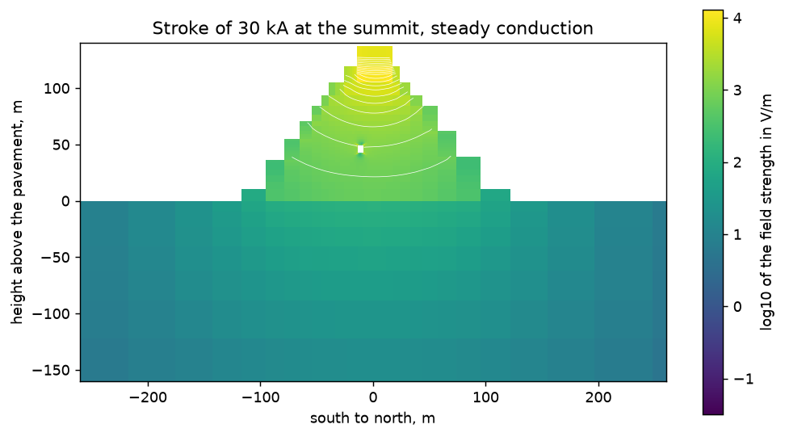

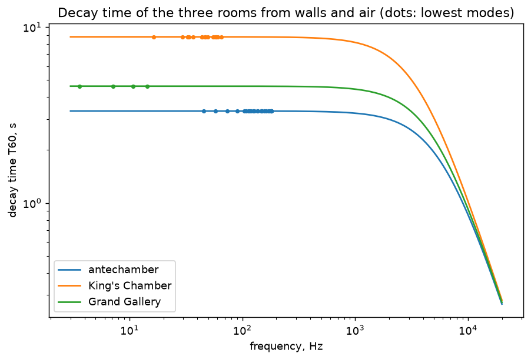

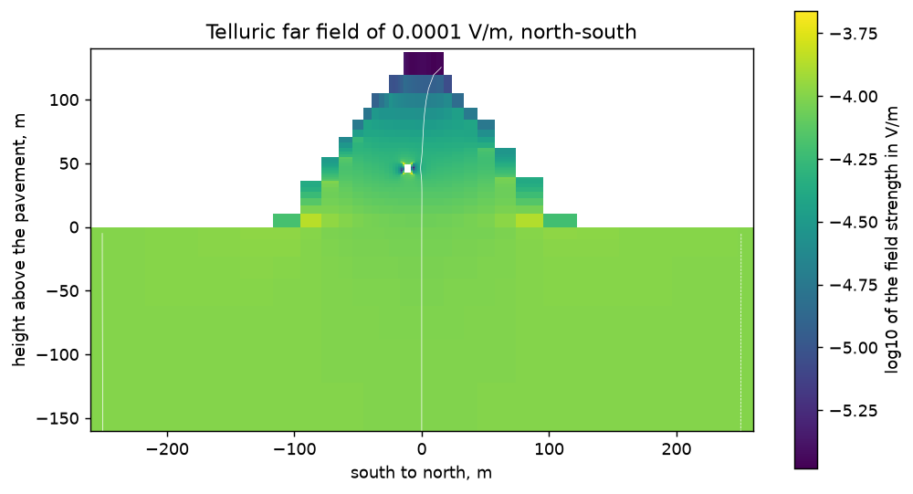

| Claim | Statement | Status | Basis |
|---|---|---|---|
| S04 | Ground currents, concentrated by ore deposits and iron veins, enter from below and build a positive electric field at the flat top. | fail | In a steady conduction model of the pyramid on bedrock, a far field of 1e-07 to 2e-02 V/m leaves 0.58 of itself (0.14 to 0.62 over the ranges of the inputs) in the masonry at chamber level and 0.036 (0.008 to 0.039) at the summit, and puts 2.2 (0.4 to 2.2) times itself in the King's Chamber granite at the peak: 0.04 V/m at the most, which is 8.8 orders of magnitude below the 2.7e+07 V/m that is, at its most generous, the field at which the piezoelectric chain first reaches a documented acoustic effect, the line this rule takes for non-negligible as a judgement call; a charge held by such a field is short by the same factor. |
| S06 | Negative cloud-to-ground lightning strikes the top, the field passes through the structure, and the granite round the King's Chamber and antechamber stores it. | fail | A stroke of 30 kA entering at the summit and spreading by steady conduction puts 4.3 kV/m in the King's Chamber granite at the peak (1.7 kV/m as a volume mean), 7.3 times the even-spreading conduction value, and 88 kV/m at the favourable corner of the ranges, the 200 kA design maximum in the most resistive masonry measured (884 V/m at the least). The piezoelectric chain needs 2.7e+07 V/m at its most generous to reach a documented acoustic effect, 303 times more than that and 8.9 times the 3e+06 V/m at which air breaks down, so the field in the granite is the conduction value and no more. A core of 5e+04 ohm m, 34 times the most resistive masonry measured in place, would bring that peak to the breakdown field, which caps it below the need. The chamber lies 1.5 skin depths (0.3 to 5.9) inside the nearest face, and induction, left out here, lowers the field there further. |
| E13 | The antechamber's upper cavity has the most striking acoustics in the pyramid. | fail | As hard-walled boxes with one assumed wall absorption, the three rooms decay at 45 Hz in: antechamber 3.3 s, King's Chamber 8.8 s, Grand Gallery 4.6 s; the quality factors of their lowest modes (45.2, 16.4, 3.6 Hz) are: antechamber 69, King's Chamber 66, Grand Gallery 8. The antechamber ranks last of three in decay time, with 0.38 of the longest other (0.27 to 0.52 over the ranges of the inputs), and first in modal quality factor, with 1.05 of the highest other (0.73 to 1.42). It is never first in decay time, so it does not rank first in both, the reading this rule takes of the criterion as a judgement call; the decay times go as volume over wall area, whatever the absorption the rooms share. With the passage mouths open it falls to 0.13 of the longest decay and 0.35 of the highest quality factor. No acoustic measurement of the antechamber exists to check the model. |
| E21 | Telluric currents concentrate over ore deposits, and the pyramids were sited for that. | fail | With two vertical sheets of the most conductive hematite measured (0.003 ohm m) in line with the far field and ending at the base, the conduction model puts 2.3 times the far field in the King's Chamber granite or at the summit (0.4 to 4.2 over sheets 0.1 to 10 m thick, 10 to 300 m deep and up to 500 m long, all assumed), against 2.2 without sheets: 0.08 V/m at the most, which is 8.5 orders of magnitude below the 2.7e+07 V/m that is, at its most generous, the field at which the piezoelectric chain first reaches a documented acoustic effect, the line this rule takes for non-negligible as a judgement call; a charge held by such a field is short by the same factor. Sheets would have to gather the far field over 1.3e+09 m to offer the chain its voltage. |

29 computed quantities. Low and high are the ends over the ledger's ranges where the package varied its inputs; they repeat the value where it ran one case

| Id | Quantity | Value | Low | High | Unit | Formula |
|---|---|---|---|---|---|---|
| electro.telluric_granite_ratio | Peak telluric field in the King's Chamber granite over the far field | 2.18 | 0.445 | 2.2 | 1 | max |E| in the granite / E0; div(sigma grad phi) = 0, far field E0 north-south, air insulating |
| electro.telluric_granite_mean_ratio | Volume-mean telluric field in the King's Chamber granite over the far field | 0.922 | 0.197 | 1.06 | 1 | mean |E| in the granite / E0; div(sigma grad phi) = 0, far field E0 north-south, air insulating |
| electro.telluric_masonry_ratio | Telluric field in the masonry beside the King's Chamber over the far field | 0.582 | 0.143 | 0.625 | 1 | mean |E| in the masonry at chamber level / E0; div(sigma grad phi) = 0, far field E0 north-south, air insulating |
| electro.telluric_summit_ratio | Telluric field in the summit masonry over the far field | 0.0358 | 0.00802 | 0.0388 | 1 | mean |E| in the top layer of masonry / E0; div(sigma grad phi) = 0, far field E0 north-south, air insulating |
| electro.telluric_field | Largest telluric field at the summit or in the granite | 0.000218 | 4.45e-08 | 0.0441 | V/m | E0 max(granite peak ratio, summit ratio); E0 the storm-time value, 1e-7 V/m at the least, the extreme at most |
| electro.ore_ratio | Largest telluric field at the summit or in the granite over the far field, with ore sheets | 2.28 | 0.445 | 4.17 | 1 | max(granite peak, summit) / E0 with two sheets of conductance t / rho_ore; div(sigma grad phi) = 0, far field E0 north-south, air insulating |
| electro.ore_field | Largest telluric field at the summit or in the granite, with ore sheets | 0.000228 | 4.45e-08 | 0.0835 | V/m | E0 times the ratio with sheets; E0 as for the sheet-free field |
| electro.lightning_granite_field | Peak field in the King's Chamber granite at the stroke's peak current | 4.35e+03 | 884 | 8.84e+04 | V/m | I max |E| per ampere in the granite; div(sigma grad phi) = 0, I entering over the summit platform, air insulating; I the median stroke, the design maximum at most |
| electro.lightning_granite_mean_field | Volume-mean field in the King's Chamber granite at the stroke's peak current | 1.75e+03 | 360 | 3.86e+04 | V/m | I mean |E| per ampere in the granite; div(sigma grad phi) = 0, I entering over the summit platform, air insulating |
| electro.lightning_conduction_multiple | Peak field in the granite over the even-spreading conduction value | 7.26 | 5.1 | 7.38 | 1 | max |E| in the granite / (rho I / section at chamber level), 04 section 4.5 |
| electro.needed_field_gas_solid | Field in the granite for the weakest documented gas-solid acoustic effect | 1.36e+10 | 2.67e+07 | 2.83e+10 | V/m | E = t_rise sqrt(2 I / Z_air) / (d L), Tier 0's pulse chain inverted; I = 0.30 W/cm2 and up |
| electro.needed_field_wet_film | Field in the granite to cavitate a wet film from the gas side | 7.44e+11 | 1.44e+09 | 1.3e+12 | V/m | E = t_rise sqrt(2 I / Z_air) / (d L), Tier 0's pulse chain inverted; I the intensity of Tier 0's required sound level |
| electro.lightning_shortfall | Field the chain needs over the peak field a stroke puts in the granite | 3.13e+06 | 303 | 3.2e+07 | 1 | needed field for the gas-solid effect / peak field in the granite |
| electro.ore_gather_length | Length of ore sheet whose whole telluric voltage would equal what the chain needs | 1.36e+14 | 1.34e+09 | 2.83e+17 | m | l = E_needed L / E0 |
| electro.lightning_breakdown_resistivity | Masonry resistivity at which the design-maximum stroke brings the granite's peak field to air breakdown | 5.09e+04 | 5.09e+04 | 5.09e+04 | ohm m | rho = rho_max E_breakdown / peak field at the favourable end; the field goes as rho I |
| electro.chamber_skin_depths | Depth of the King's Chamber inside the nearest face, in skin depths at the stroke's frequency | 1.49 | 0.274 | 5.89 | 1 | distance from the chamber's centre to the nearest face / Tier 0 skin depth |
| electro.lowest_mode_antechamber | Lowest mode of the antechamber as a hard-walled box | 45.2 | 45.2 | 45.2 | Hz | f = c / (2 L) |
| electro.decay_time_antechamber | Decay time of the antechamber at the antechamber's lowest mode | 3.33 | 0.94 | 9.02 | s | T60 = 24 ln(10) V / (c (alpha S + 4 m V)) |
| electro.modal_q_antechamber | Quality factor of the lowest mode of the antechamber | 68.5 | 19.3 | 186 | 1 | Q = 2 pi f T60 / (6 ln 10) at f = c / (2 L) |
| electro.lowest_mode_kings_chamber | Lowest mode of the King's Chamber as a hard-walled box | 16.4 | 16.4 | 16.4 | Hz | f = c / (2 L) |
| electro.decay_time_kings_chamber | Decay time of the King's Chamber at the antechamber's lowest mode | 8.8 | 3.5 | 17.7 | s | T60 = 24 ln(10) V / (c (alpha S + 4 m V)) |
| electro.modal_q_kings_chamber | Quality factor of the lowest mode of the King's Chamber | 65.6 | 26.1 | 132 | 1 | Q = 2 pi f T60 / (6 ln 10) at f = c / (2 L) |
| electro.lowest_mode_grand_gallery | Lowest mode of the Grand Gallery as a hard-walled box | 3.59 | 3.59 | 3.59 | Hz | f = c / (2 L) |
| electro.decay_time_grand_gallery | Decay time of the Grand Gallery at the antechamber's lowest mode | 4.61 | 1.7 | 12.5 | s | T60 = 24 ln(10) V / (c (alpha S + 4 m V)) |
| electro.modal_q_grand_gallery | Quality factor of the lowest mode of the Grand Gallery | 7.53 | 2.77 | 20.3 | 1 | Q = 2 pi f T60 / (6 ln 10) at f = c / (2 L) |
| electro.decay_lead | Antechamber decay time over the longest of the other two rooms | 0.379 | 0.266 | 0.515 | 1 | T60 of the antechamber / max T60 of the others |
| electro.quality_lead | Quality factor of the antechamber's lowest mode over the highest of the other two rooms | 1.05 | 0.734 | 1.42 | 1 | Q of the antechamber / max Q of the others |
| electro.decay_lead_open | Antechamber decay time over the longest of the other two rooms, passage mouths open | 0.126 | 0.067 | 0.25 | 1 | as decay_lead with A = alpha S + open mouths + 4 m V |
| electro.quality_lead_open | Quality factor of the antechamber's lowest mode over the highest other, passage mouths open | 0.347 | 0.185 | 0.689 | 1 | as quality_lead with A = alpha S + open mouths + 4 m V |

11 modelling assumptions

- Conduction is steady; the stroke is taken at its peak current as if steady, which leaves out induction and so overstates the field at the chamber.
- The pyramid is homogeneous masonry in its designed square shape, cut off at today's platform, on a half-space of bedrock; the air is insulating; joints, casing and a wetter skin are not drawn.
- The King's Chamber is an insulating cavity lined with a granite shell of one assumed thickness; the relieving chambers, the antechamber and every other void are left out.
- The granite's peak field is the largest cell value on cells of about one metre; it grows by about a tenth each time the cells are halved because the field is singular along the cavity's edges, while the volume mean is converged to about 2 percent.
- An ore body is a pair of vertical sheets of the most conductive hematite measured, in line with the far field and ending at the base edges; their thickness, depth and length are assumed and swept.
- The telluric far field runs north-south, across the chamber's short side, which gives a resistive body the larger field.
- The field the granite needs is Tier 0's pulse chain run backwards, with every part of the chain at its most generous for the favourable end.
- Non-negligible, in the criteria of S04 and E21, is read as reaching the field that chain needs: a judgement call.
- The rooms are hard-walled boxes with Sabine decay from the walls and the air: one assumed wall absorption shared by the three rooms, and air absorption as frequency squared scaled to the ledger's 13 kHz value; open passage mouths are a sensitivity case only.
- The field in the lining of a gas-filled chamber is capped at the air-breakdown field, whatever the masonry's resistivity.
- Ranks first, in the criterion of E13, is read as first in both decay time and modal quality factor: a judgement call.

## The 2018 electromagnetic study: two full-wave field solvers

2 claims: 2 fail.

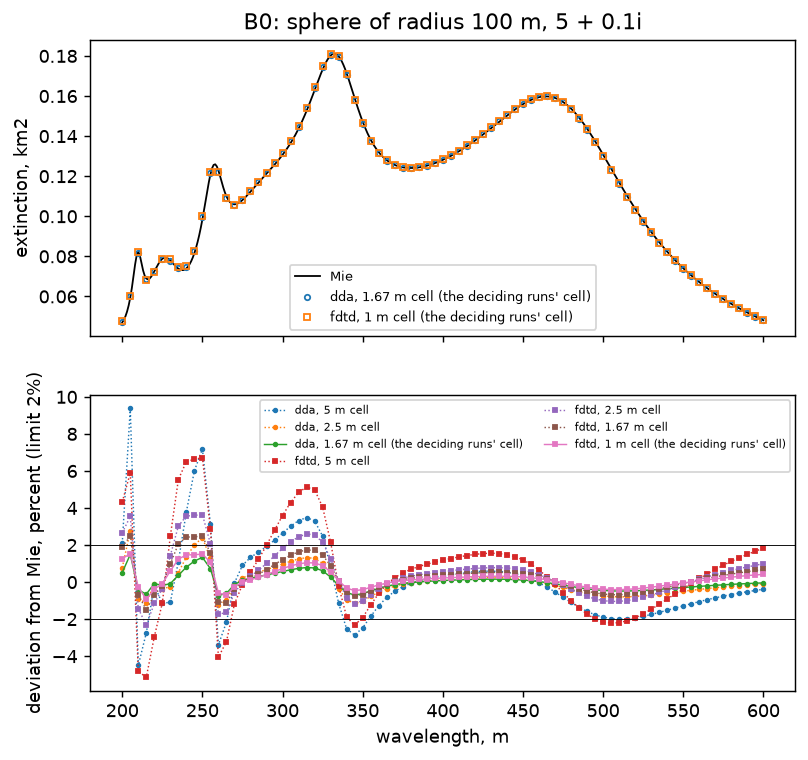

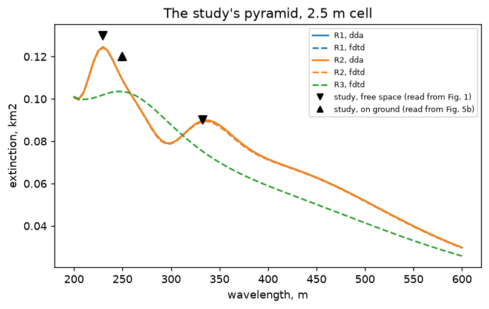

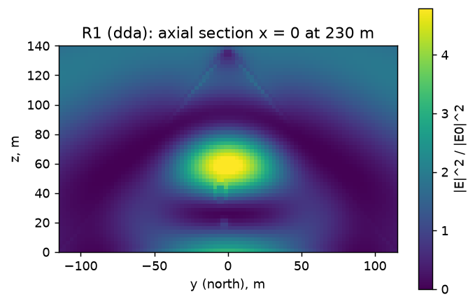

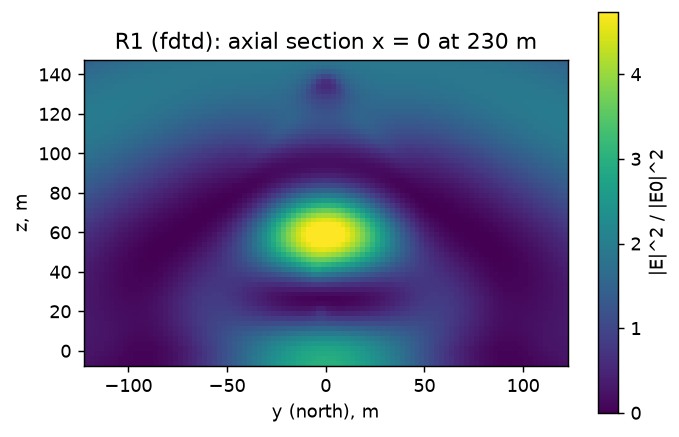

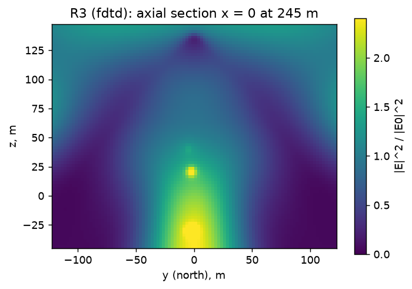

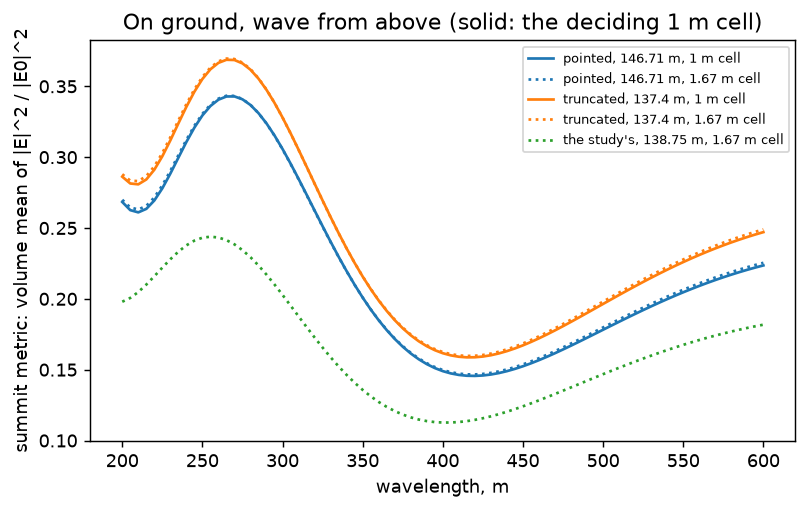

| Claim | Statement | Status | Basis |
|---|---|---|---|
| E19 | Cited 2018 study: the pyramid's shape concentrates electric field near the King's Chamber for waves from above and at the top for waves from below. | fail | As modelled (not met): the band-maximum volume-mean intensity ratio in the King's Chamber of case R1 is 9.21 against 6.94 in its control cube (1.33 times) in the time-domain solver at a 1 m cell; 10.44 against 7.66 in its control cube (1.36 times) in the dipole solver at a 1.67 m cell; at the next coarser cell, which decides nothing: 10.12 against 7.51 in its control cube (1.35 times) in the time-domain solver at a 1.67 m cell; 10.80 against 7.75 in its control cube (1.39 times) in the dipole solver at a 2.5 m cell; the criterion asks for at least 2 times the control. Under realism (fail): in case V4 the ratio is in the time-domain solver at a 1 m cell 0.026 at 6.7e-04 S/m against 0.018 in its control, 0.00087 at 1.5e-03 S/m against 0.00046 in its control, 1.7e-05 at 3.3e-03 S/m against 7e-06 in its control, 0.021 at 6.7e-04 S/m (permittivity 5), 0.031 at 6.7e-04 S/m (permittivity 9); at the next coarser cell, which decides nothing: in the time-domain solver at a 1.67 m cell 0.025 at 6.7e-04 S/m against 0.017 in its control, 1.8e-05 at 3.3e-03 S/m against 8.3e-06 in its control; the criterion asks for at least 2 and at least 2 times the control across the measured conductivity range, and fails the claim if the ratio is below 2 at the low end of that range. Each part is decided by the runs at the cells where the solver's benchmark sphere is within 2% of the exact one, and is conditional if those runs and the next coarser cell fall on different sides. The spec gives no rule for joining the two parts: the claim fails when the realism part fails, passes when both pass, and is conditional otherwise. Not varied: the as-modelled part is case R1, which the criterion names, at the study's permittivity of 5 (its range is 4 to 6), so it is settled at that value only, and R1's maximum lies at the short end of the band, 200 m, so a resonance just below the band could enter it at a higher permittivity; V4 has a granite shell of 1.5 m (range 1 to 3 m), a granite permittivity of 6 (3.5 to 24) and a granite conductivity of 1e-08 S/m (up to 1e-04); the shell is metres thick against a skin depth of 24 to 32 m in the masonry at 6.7e-04 S/m. |
| E20 | The speaker's reading of that study: the field excludes the tip, so the flat top is functional and there never was a capstone. | fail | On ground, with the wave from above, the band-maximum volume mean of the intensity ratio in the top masonry is 0.37 for the apex cut at the present top against 0.34 for the pointed apex (1.08 times) in the time-domain solver at a 1 m cell; at the next coarser cell, which decides nothing: 0.37 for the apex cut at the present top against 0.34 for the pointed apex (1.08 times; 0.24 for the study's apex) in the time-domain solver at a 1.67 m cell. The criterion passes the claim only if the truncated apex gives at least 2 times the pointed one; the runs at the cell where the solver's benchmark sphere is within 2% of the exact one decide. Not varied: both apexes are run at the study's permittivity of 5 + 0.1i and in the time-domain solver alone, the one of the two that carries a ground. |

59 computed quantities. Low and high are the ends over the ledger's ranges where the package varied its inputs; they repeat the value where it ran one case

| Id | Quantity | Value | Low | High | Unit | Formula |
|---|---|---|---|---|---|---|
| em.b0_deviation_dda_5 | B0: worst deviation of the dda extinction from Mie at a 5 m cell | 0.0938 | 0.0938 | 0.0938 | 1 | max |sigma_ext / Mie - 1| over the band |
| em.b0_deviation_dda_2p5 | B0: worst deviation of the dda extinction from Mie at a 2.5 m cell | 0.0277 | 0.0277 | 0.0277 | 1 | max |sigma_ext / Mie - 1| over the band |
| em.b0_deviation_dda_1p67 | B0: worst deviation of the dda extinction from Mie at a 1.67 m cell | 0.0149 | 0.0149 | 0.0149 | 1 | max |sigma_ext / Mie - 1| over the band |
| em.b0_deviation_fdtd_5 | B0: worst deviation of the fdtd extinction from Mie at a 5 m cell | 0.0672 | 0.0672 | 0.0672 | 1 | max |sigma_ext / Mie - 1| over the band |
| em.b0_deviation_fdtd_2p5 | B0: worst deviation of the fdtd extinction from Mie at a 2.5 m cell | 0.0364 | 0.0364 | 0.0364 | 1 | max |sigma_ext / Mie - 1| over the band |
| em.b0_deviation_fdtd_1p67 | B0: worst deviation of the fdtd extinction from Mie at a 1.67 m cell | 0.0248 | 0.0248 | 0.0248 | 1 | max |sigma_ext / Mie - 1| over the band |
| em.b0_deviation_fdtd_1 | B0: worst deviation of the fdtd extinction from Mie at a 1 m cell | 0.0154 | 0.0154 | 0.0154 | 1 | max |sigma_ext / Mie - 1| over the band |
| em.r1_peak1_wavelength_dda | R1: extinction maximum 1 (dda), wavelength | 230 | 230 | 230 | m | local maximum of the extinction spectrum |
| em.r1_peak1_extinction_dda | R1: extinction maximum 1 (dda) | 1.25e+05 | 1.25e+05 | 1.25e+05 | m2 | extinction cross-section at that maximum |
| em.r1_peak2_wavelength_dda | R1: extinction maximum 2 (dda), wavelength | 336 | 336 | 336 | m | local maximum of the extinction spectrum |
| em.r1_peak2_extinction_dda | R1: extinction maximum 2 (dda) | 8.99e+04 | 8.99e+04 | 8.99e+04 | m2 | extinction cross-section at that maximum |
| em.r2_peak_extinction_dda | R2: band maximum of the extinction (dda) | 1.25e+05 | 1.25e+05 | 1.25e+05 | m2 | largest extinction cross-section in the band, wave from the base side |
| em.r1_kings_mean_dda | R1: band-maximum volume-mean intensity ratio, kings (dda) | 10.8 | 10.8 | 10.8 | 1 | max over the band of the volume mean of |E|^2 / |E0|^2 |
| em.r1_kings_max_dda | R1: band-maximum peak intensity ratio, kings (dda) | 12.6 | 12.6 | 12.6 | 1 | max over the band and the chamber of |E|^2 / |E0|^2 |
| em.r2_kings_mean_dda | R2: band-maximum volume-mean intensity ratio, kings (dda) | 3.29 | 3.29 | 3.29 | 1 | max over the band of the volume mean of |E|^2 / |E0|^2 |
| em.r2_kings_max_dda | R2: band-maximum peak intensity ratio, kings (dda) | 3.91 | 3.91 | 3.91 | 1 | max over the band and the chamber of |E|^2 / |E0|^2 |
| em.r1_queens_mean_dda | R1: band-maximum volume-mean intensity ratio, queens (dda) | 8.87 | 8.87 | 8.87 | 1 | max over the band of the volume mean of |E|^2 / |E0|^2 |
| em.r1_queens_max_dda | R1: band-maximum peak intensity ratio, queens (dda) | 9.24 | 9.24 | 9.24 | 1 | max over the band and the chamber of |E|^2 / |E0|^2 |
| em.r2_queens_mean_dda | R2: band-maximum volume-mean intensity ratio, queens (dda) | 5.97 | 5.97 | 5.97 | 1 | max over the band of the volume mean of |E|^2 / |E0|^2 |
| em.r2_queens_max_dda | R2: band-maximum peak intensity ratio, queens (dda) | 6.35 | 6.35 | 6.35 | 1 | max over the band and the chamber of |E|^2 / |E0|^2 |
| em.r1_peak1_wavelength_fdtd | R1: extinction maximum 1 (fdtd), wavelength | 230 | 230 | 230 | m | local maximum of the extinction spectrum |
| em.r1_peak1_extinction_fdtd | R1: extinction maximum 1 (fdtd) | 1.24e+05 | 1.24e+05 | 1.24e+05 | m2 | extinction cross-section at that maximum |
| em.r1_peak2_wavelength_fdtd | R1: extinction maximum 2 (fdtd), wavelength | 336 | 336 | 336 | m | local maximum of the extinction spectrum |
| em.r1_peak2_extinction_fdtd | R1: extinction maximum 2 (fdtd) | 8.94e+04 | 8.94e+04 | 8.94e+04 | m2 | extinction cross-section at that maximum |
| em.r2_peak_extinction_fdtd | R2: band maximum of the extinction (fdtd) | 1.24e+05 | 1.24e+05 | 1.24e+05 | m2 | largest extinction cross-section in the band, wave from the base side |
| em.r1_kings_mean_fdtd | R1: band-maximum volume-mean intensity ratio, kings (fdtd) | 10.7 | 10.7 | 10.7 | 1 | max over the band of the volume mean of |E|^2 / |E0|^2 |
| em.r1_kings_max_fdtd | R1: band-maximum peak intensity ratio, kings (fdtd) | 10.6 | 10.6 | 10.6 | 1 | max over the band and the chamber of |E|^2 / |E0|^2 |
| em.r2_kings_mean_fdtd | R2: band-maximum volume-mean intensity ratio, kings (fdtd) | 3.26 | 3.26 | 3.26 | 1 | max over the band of the volume mean of |E|^2 / |E0|^2 |
| em.r2_kings_max_fdtd | R2: band-maximum peak intensity ratio, kings (fdtd) | 3.14 | 3.14 | 3.14 | 1 | max over the band and the chamber of |E|^2 / |E0|^2 |
| em.r1_queens_mean_fdtd | R1: band-maximum volume-mean intensity ratio, queens (fdtd) | 6.74 | 6.74 | 6.74 | 1 | max over the band of the volume mean of |E|^2 / |E0|^2 |
| em.r1_queens_max_fdtd | R1: band-maximum peak intensity ratio, queens (fdtd) | 7.02 | 7.02 | 7.02 | 1 | max over the band and the chamber of |E|^2 / |E0|^2 |
| em.r2_queens_mean_fdtd | R2: band-maximum volume-mean intensity ratio, queens (fdtd) | 4.52 | 4.52 | 4.52 | 1 | max over the band of the volume mean of |E|^2 / |E0|^2 |
| em.r2_queens_max_fdtd | R2: band-maximum peak intensity ratio, queens (fdtd) | 4.77 | 4.77 | 4.77 | 1 | max over the band and the chamber of |E|^2 / |E0|^2 |
| em.r3_peak_wavelength | R3: wavelength of the on-ground extinction maximum (fdtd) | 247 | 247 | 247 | m | largest scattered plus absorbed power over incident intensity |
| em.r3_peak_extinction | R3: on-ground extinction maximum (fdtd) | 1.04e+05 | 1.04e+05 | 1.04e+05 | m2 | largest scattered plus absorbed power over incident intensity |
| em.r1_peak1_wavelength_dda_1p67 | R1: extinction maximum 1 (dda, 1.67 m cell), wavelength | 230 | 230 | 230 | m | local maximum of the extinction spectrum |
| em.r1_peak1_extinction_dda_1p67 | R1: extinction maximum 1 (dda, 1.67 m cell) | 1.25e+05 | 1.25e+05 | 1.25e+05 | m2 | extinction cross-section at that maximum |
| em.r1_peak2_wavelength_dda_1p67 | R1: extinction maximum 2 (dda, 1.67 m cell), wavelength | 337 | 337 | 337 | m | local maximum of the extinction spectrum |
| em.r1_peak2_extinction_dda_1p67 | R1: extinction maximum 2 (dda, 1.67 m cell) | 9e+04 | 9e+04 | 9e+04 | m2 | extinction cross-section at that maximum |
| em.e19_r1_over_control_fdtd_1 | R1 over its control, King's Chamber volume mean, time-domain solver, 1 m cell (decides) | 1.33 | 1.33 | 1.33 | 1 | band maximum in R1 over band maximum in the cube |
| em.e19_v4_eps7_6p7em04_fdtd_1 | V4 King's Chamber volume mean at 6.7e-04 S/m , time-domain solver, 1 m cell (decides) | 0.0259 | 0.0212 | 0.0315 | 1 | band maximum of the volume mean of |E|^2 / |E0|^2 |
| em.e19_v4_eps7_1p5em03_fdtd_1 | V4 King's Chamber volume mean at 1.5e-03 S/m , time-domain solver, 1 m cell (decides) | 0.000874 | 0.000874 | 0.000874 | 1 | band maximum of the volume mean of |E|^2 / |E0|^2 |
| em.e19_v4_eps7_3p3em03_fdtd_1 | V4 King's Chamber volume mean at 3.3e-03 S/m , time-domain solver, 1 m cell (decides) | 1.71e-05 | 1.71e-05 | 1.71e-05 | 1 | band maximum of the volume mean of |E|^2 / |E0|^2 |
| em.e19_v4_permittivity_5_6p7em04_fdtd_1 | V4 King's Chamber volume mean at 6.7e-04 S/m permittivity 5, time-domain solver, 1 m cell (decides) | 0.0212 | 0.0212 | 0.0212 | 1 | band maximum of the volume mean of |E|^2 / |E0|^2 |
| em.e19_v4_permittivity_9_6p7em04_fdtd_1 | V4 King's Chamber volume mean at 6.7e-04 S/m permittivity 9, time-domain solver, 1 m cell (decides) | 0.0315 | 0.0315 | 0.0315 | 1 | band maximum of the volume mean of |E|^2 / |E0|^2 |
| em.e20_summit_ratio_fdtd_1 | Summit metric, truncated over pointed apex, on ground, time-domain solver, 1 m cell (decides) | 1.08 | 1.08 | 1.08 | 1 | band maximum for the apex cut at the present top over the pointed apex |
| em.e19_r1_over_control_fdtd_1p67 | R1 over its control, King's Chamber volume mean, time-domain solver, 1.67 m cell (resolution check, decides nothing) | 1.35 | 1.35 | 1.35 | 1 | band maximum in R1 over band maximum in the cube |
| em.e19_v4_eps7_6p7em04_fdtd_1p67 | V4 King's Chamber volume mean at 6.7e-04 S/m , time-domain solver, 1.67 m cell (resolution check, decides nothing) | 0.0247 | 0.0247 | 0.0247 | 1 | band maximum of the volume mean of |E|^2 / |E0|^2 |
| em.e19_v4_eps7_3p3em03_fdtd_1p67 | V4 King's Chamber volume mean at 3.3e-03 S/m , time-domain solver, 1.67 m cell (resolution check, decides nothing) | 1.77e-05 | 1.77e-05 | 1.77e-05 | 1 | band maximum of the volume mean of |E|^2 / |E0|^2 |
| em.e20_summit_ratio_fdtd_1p67 | Summit metric, truncated over pointed apex, on ground, time-domain solver, 1.67 m cell (resolution check, decides nothing) | 1.08 | 1.08 | 1.08 | 1 | band maximum for the apex cut at the present top over the pointed apex |
| em.e19_r1_over_control_fdtd_2p5 | R1 over its control, King's Chamber volume mean, time-domain solver, 2.5 m cell (for information, decides nothing) | 1.37 | 1.37 | 1.37 | 1 | band maximum in R1 over band maximum in the cube |
| em.e19_v4_eps7_6p7em04_fdtd_2p5 | V4 King's Chamber volume mean at 6.7e-04 S/m , time-domain solver, 2.5 m cell (for information, decides nothing) | 0.0377 | 0.0322 | 0.0444 | 1 | band maximum of the volume mean of |E|^2 / |E0|^2 |
| em.e19_v4_eps7_1p5em03_fdtd_2p5 | V4 King's Chamber volume mean at 1.5e-03 S/m , time-domain solver, 2.5 m cell (for information, decides nothing) | 0.00125 | 0.00125 | 0.00125 | 1 | band maximum of the volume mean of |E|^2 / |E0|^2 |
| em.e19_v4_eps7_3p3em03_fdtd_2p5 | V4 King's Chamber volume mean at 3.3e-03 S/m , time-domain solver, 2.5 m cell (for information, decides nothing) | 2.09e-05 | 2.09e-05 | 2.09e-05 | 1 | band maximum of the volume mean of |E|^2 / |E0|^2 |
| em.e19_v4_permittivity_5_6p7em04_fdtd_2p5 | V4 King's Chamber volume mean at 6.7e-04 S/m permittivity 5, time-domain solver, 2.5 m cell (for information, decides nothing) | 0.0322 | 0.0322 | 0.0322 | 1 | band maximum of the volume mean of |E|^2 / |E0|^2 |
| em.e19_v4_permittivity_9_6p7em04_fdtd_2p5 | V4 King's Chamber volume mean at 6.7e-04 S/m permittivity 9, time-domain solver, 2.5 m cell (for information, decides nothing) | 0.0444 | 0.0444 | 0.0444 | 1 | band maximum of the volume mean of |E|^2 / |E0|^2 |
| em.e20_summit_ratio_fdtd_2p5 | Summit metric, truncated over pointed apex, on ground, time-domain solver, 2.5 m cell (for information, decides nothing) | 1.06 | 1.06 | 1.06 | 1 | band maximum for the apex cut at the present top over the pointed apex |
| em.e19_r1_over_control_dda_1p67 | R1 over its control, King's Chamber volume mean, dipole solver, 1.67 m cell (decides) | 1.36 | 1.36 | 1.36 | 1 | band maximum in R1 over band maximum in the cube |
| em.e19_r1_over_control_dda_2p5 | R1 over its control, King's Chamber volume mean, dipole solver, 2.5 m cell (resolution check, decides nothing) | 1.39 | 1.39 | 1.39 | 1 | band maximum in R1 over band maximum in the cube |

11 modelling assumptions

- The wave travels along the axis and is polarised east-west; field ratios are over the incident intensity, also on ground.
- Chambers are air; the study's chambers are read as pyramid.geometry reads them (length east-west, offset to the south).
- A cell cut by a surface answers along the surface with its mean permittivity and across it with its mean inverse permittivity.
- A time-domain run has one conductivity; the study's constant imaginary permittivity is interpolated from three runs.
- Extinction in the time-domain solver is scattered power through a closed box plus power absorbed in the body; on ground the body is what stands above z = 0.
- The ground is the masonry's material; V2 keeps the study's outer pyramid; the V3 apexes are the surveyed pyramid whole and cut at the present top, with the study's chambers.
- V4 is the truncated surveyed pyramid with the surveyed King's and Queen's Chambers and Grand Gallery, a granite shell of emx.granite_shell, permittivity em.limestone_eps.
- The band maximum of a metric is its largest value on the 5 m wavelength grid.
- A verdict rests only on runs at a cell where that solver's benchmark sphere is within 2 percent of the exact one across the band; the next coarser cell is the resolution check and a claim is conditional when it falls on the other side: that run can move a word to conditional only, never to pass or fail.
- Where both solvers decide a part (R1 against its control) and fall on different sides, the part is conditional.
- The convergence and reproduction gates compare the pyramid's extinction at the coarse cell and its half, where the sphere is outside the benchmark limit; only the deciding runs were repeated at the finer cells.

